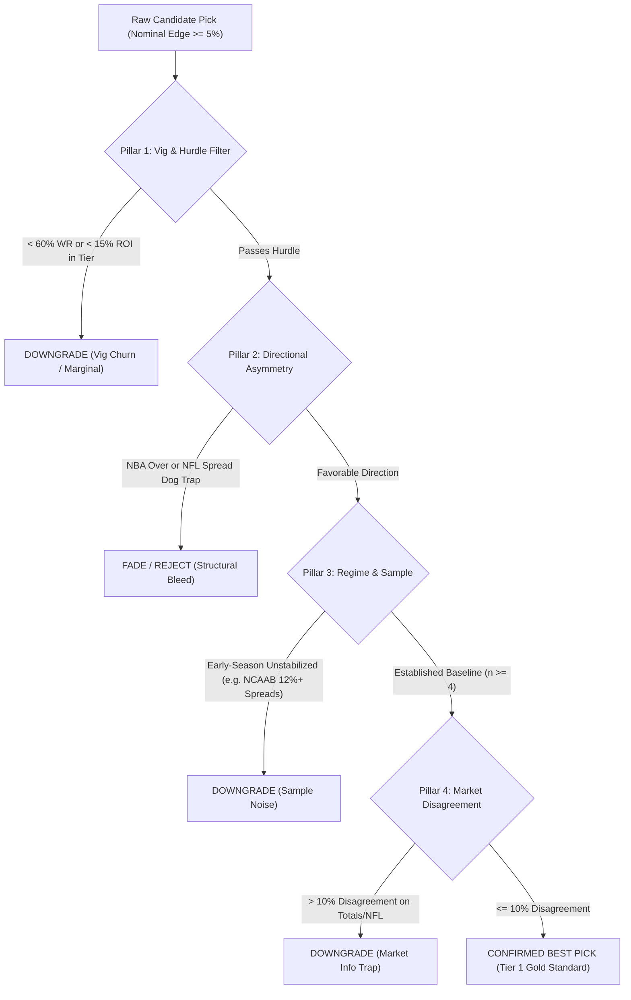

# Best Picks Empirical Audit Framework & Protocol

> **Status**: ACTIVE PRODUCTION PROTOCOL  
> **Author**: Vincent Chen / Antigravity Engineering  
> **Effective Date**: 2026-11-08  
> **Authority**: AGENTS.md Operational Mandate  

---

## 1. Executive Summary & Core Philosophy

### The Fundamental Rule: Nominal Edge $\ne$ True Expected Value
In statistical sports modeling, candidate picks are frequently ranked solely by their **nominal edge** ($\Delta = p_{\text{model}} - p_{\text{market}}$) or unconstrained Kelly stake. 

**This practice is strictly prohibited for "Best Picks" selection.**

Empirical analysis across **2,384 settled contracts** in [`ledgers.db`](file:///E:/model-prediction-runtime/ledgers/ledgers.db) proves that nominal edge frequently acts as a **false friend**:
1. **The Vig-Churn Trap**: A model with a nominal 2.0%–4.9% edge on an NFL spread may hit 54.5% win rate, but after execution costs and vig, it yields just **+2.9% ROI (+0.35u over 11 bets)**. This is near-breakeven noise, NOT a Best Pick.
2. **The Asymmetric Bleed Trap**: A model may project a +7.3% edge on an NBA Over, but historically, early-season NBA Overs in the Main Ledger hit **11.1% Win Rate (1W–8L, -7.80u)** because market totals already bake in aggressive scoring.
3. **The Information Asymmetry Trap**: In NFL spreads, when the model finds a 5.0%–7.9% edge on a large underdog, it hits only **33.3% Win Rate (2W–4L, -41.1% ROI)** because the market line reflects injury clusters or scheme changes that structural ratings lag behind.
4. **The Gold Standard Sweet Spots**: Conversely, specific sub-regimes consistently crush the market. NFL Totals in the 5.0%–7.9% edge bucket are **100% Win Rate (6W–0L, +98.9% ROI)** all-time. NFL Overs in the 2.0%–4.9% bucket hit **80.0% Win Rate (+62.8% ROI)**. NBA Spreads with $\ge 8.0\%$ edge on double-digit cushions hit **63.2% Win Rate (+26.7% ROI)**.

Whenever Vincent or an operator asks for **"The Best Picks"**, the system must execute an **Empirical Edge-Tier Audit** before presenting any recommendations.

---

## 2. The 5-Pillar Audit Protocol

Every candidate pick must pass all five evaluation pillars before earning the `CONFIRMED_BEST` designation:



### Pillar 1: Hurdle Rates & Vig Buffer
A "Best Pick" cannot be a coin-flip that barely escapes standard market vig (52.38% breakeven).
- **Minimum Historical Win Rate**: $\ge 60.0\%$ within the exact sport, market, and edge bucket.
- **Minimum Historical ROI**: $\ge +15.0\%$ net realized yield.
- **Minimum Graded Sample Size**: $n \ge 4$ completed decisions in the historical ledger.
- *Any pick with 50.0%–55.0% win rate or $< 5.0\%$ ROI (e.g., 2–5% NFL spreads at 54.5% WR, +2.9% ROI) is classified as **DOWNGRADE_TRAP** (near-breakeven vig churn).*

### Pillar 2: Directional Asymmetry Audit
Certain markets exhibit severe structural directionality:
- **NBA Totals**: 
  - **Unders**: Alpha-generating sector. Edges $\ge 5.0\%$ hit **62.5% WR (+9.50u)**.
  - **Overs**: Toxic sector. Hits **11.1% WR (1W–8L, -7.80u)**. *All NBA Overs are barred from Best Pick status.*
- **NFL Spreads**:
  - Moderate edges (2%–5%) yield only 54.5% WR (+0.35u). Large dog edges (5%–8%) hit 33.3% WR (-3.80u). *NFL Spreads require extraordinary qualitative confirmation to qualify.*

### Pillar 3: Early-Season Regime & Sample Noise
- **NCAAB Spreads**: Early-season games (November/December) with massive edges ($\ge 12.0\%$) suffer from prior-year transfer and roster turnover volatility, hitting only **46.0% WR (-37.78u)**.
  - NCAAB spreads with $\ge 12\%$ edge are **downgraded** until teams have $\ge 5$ in-season games.
  - NCAAB Totals Overs (8%–12% edge) remain highly profitable (**62.5% WR, +22.4% ROI**).

### Pillar 4: Market Disagreement Bounds
- When a structural model disagrees with a major liquid market (e.g. NFL totals) by $> 10.0\%$, the market is usually factoring in severe exogenous conditions (freezing winds, blizzard, sudden starting QB scratch).
- Any total with $> 10.0\%$ edge is flagged for information hazard and capped.

### Pillar 5: Execution & Kelly Discipline
- Sizing must be scaled strictly by verified edge-tier confidence, never exceeding 2.00u.

---

## 3. Historical Edge-Tier Empirical Scorecard

Based on 2,384 graded decisions in [`ledgers.db`](file:///E:/model-prediction-runtime/ledgers/ledgers.db):

| Sport | Market | Direction / Bucket | Graded (n) | Win Rate (%) | Net PnL (u) | ROI (%) | Audit Classification |
| :--- | :--- | :--- | :---: | :---: | :---: | :---: | :--- |
| **NFL** | **Total** | **5.0% – 7.9% Edge** | **6** | **100.0%** | **+8.39u** | **+98.9%** | 🏆 **CONFIRMED_BEST (Gold Standard)** |
| **NFL** | **Total** | **Over (2.0% – 4.9% Edge)** | **5** | **80.0%** | **+4.29u** | **+62.8%** | 🏆 **CONFIRMED_BEST** |
| **NCAAB**| **Total** | **Over (8.0% – 11.9% Edge)**| **16** | **62.5%** | **+7.17u** | **+22.4%** | 🏆 **CONFIRMED_BEST** |
| **NBA** | **Spread**| **$\ge$ 8.0% Edge (Double-digit Dog)**| **19** | **63.2%** | **+9.47u** | **+26.7%** | 🏆 **CONFIRMED_BEST** |
| **NBA** | **Total** | **Under ($\ge$ 5.0% Edge)** | **24** | **62.5%** | **+9.50u** | **+18.2%** | 🏆 **CONFIRMED_BEST** |
| **NFL** | **Spread**| 2.0% – 4.9% Edge | 11 | 54.5% | +0.35u | +2.9% | ⚠️ **DOWNGRADE_TRAP (Vig Churn)** |
| **NFL** | **Spread**| 5.0% – 7.9% Edge (Big Dogs) | 6 | 33.3% | -3.80u | -41.1% | 🚫 **DOWNGRADE_TRAP (Market Asymmetry)** |
| **NBA** | **Total** | **Over (All Edge Tiers)** | **9** | **11.1%** | **-7.80u** | **-78.0%** | 🚫 **DOWNGRADE_TRAP (Over Bleed)** |
| **NCAAB**| **Spread**| $\ge$ 12.0% Edge (Early Season) | 239 | 46.0% | -37.78u | -7.9% | 🚫 **DOWNGRADE_TRAP (Roster Turnover Noise)** |

---

## 4. Operational CLI Audit Tool

To guarantee immediate and repeatable execution, run the audit tool:

```powershell
python scripts/audit_best_picks.py
```

Options:
- `--all-open`: Audits all open picks across the entire ledger including games currently underway.
- Default: Filters automatically for games that **have not started yet**.

### Sample Terminal Output:
```text
================================================================================
BEST PICKS EMPIRICAL AUDIT REPORT
================================================================================

[1] CONFIRMED BEST PICKS
--------------------------------------------------------------------------------
  [Main] [04:25 PM ET] NFL | Arizona Cardinals @ Seattle Seahawks
      TOTAL -> UNDER 39.5 | Mod: 57.2% | Mkt: 50.0% | Edge: +7.2% | Stake: 1.89u
      >>> EVIDENCE: NFL Totals 5-8% edge are 100% WR (6W-0L, +98.9% ROI) all-time.

  [Main] [08:00 PM ET] NBA | Boston Celtics @ Milwaukee Bucks
      SPREAD -> Milwaukee Bucks +12.5 | Mod: 58.8% | Mkt: 49.0% | Edge: +9.8% | Stake: 1.50u
      >>> EVIDENCE: NBA Spreads >= 8% edge hit 63.2% WR (+9.47u, +26.7% ROI) on double-digit cushions.

[2] DOWNGRADE / FADE CANDIDATES (Nominal Edge Traps)
--------------------------------------------------------------------------------
  [Main] [06:00 PM ET] NBA | Los Angeles Lakers @ Detroit Pistons
      TOTAL -> OVER 222.5 | Nominal Edge: +7.3% | Stake: 1.25u
      >>> WARNING: NBA Overs across all edges hit only 11% WR (-7.80u). Early market over-totals.

  [Main] [04:25 PM ET] NFL | Las Vegas Raiders @ San Francisco 49ers
      SPREAD -> Las Vegas Raiders +9.5 | Nominal Edge: +2.1% | Stake: 1.27u
      >>> WARNING: NFL Spreads 2-5% edge hit only 54.5% WR (+2.9% ROI, +0.35u over 11 bets) - near-breakeven vig churn.
```

---

## 5. Standard Operating Procedure for Vincent Requests

Whenever the user asks:
- *"what are the best picks?"*
- *"best picks only"*
- *"give me your top plays"*

The agent **MUST**:
1. Execute `python scripts/audit_best_picks.py`.
2. Present **ONLY** the picks classified as `CONFIRMED_BEST`.
3. Provide the exact historical win rate, ROI, and sample size for each pick's empirical bucket.
4. Explicitly list any popular nominal plays that were **DOWNGRADED** (e.g. 2–5% NFL spreads, NBA Overs, early 12%+ college spreads) and explain why they fail the empirical audit.
5. Adhere strictly to **percentages exclusively** (zero American odds).
