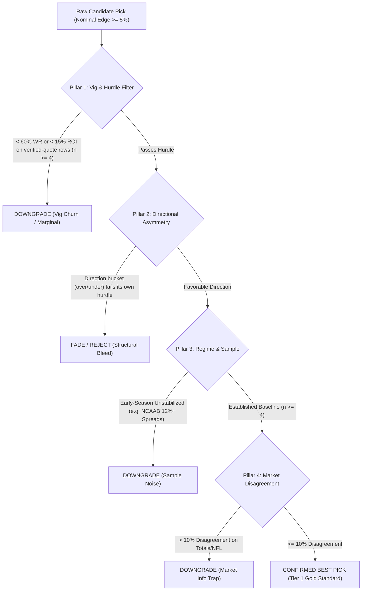

# Best Picks Empirical Audit Framework & Protocol

> **Status**: ACTIVE PRODUCTION PROTOCOL  
> **Author**: Vincent Chen / Antigravity Engineering  
> **Effective Date**: 2026-11-11  
> **Authority**: AGENTS.md Operational Mandate  

---

## 1. Executive Summary & Core Philosophy

### The Fundamental Rule: Nominal Edge $\ne$ True Expected Value
In statistical sports modeling, candidate picks are frequently ranked solely by their **nominal edge** ($\Delta = p_{\text{model}} - p_{\text{market}}$) or unconstrained Kelly stake. 

**This practice is strictly prohibited for "Best Picks" selection.**

Historical analysis of settled contracts in [`ledgers.db`](file:///E:/model-prediction-runtime/ledgers/ledgers.db) shows that nominal edge frequently acts as a **false friend**. Four recurring patterns matter, as concepts -- not as fixed numbers, because every number below drifts as new decisions settle:
1. **The Vig-Churn Trap**: a nominal edge that clears the model's own hurdle can still settle at a win rate barely above the sportsbook's vig line, netting near-zero realized ROI after costs. This is near-breakeven noise, NOT a Best Pick.
2. **The Asymmetric Bleed Trap**: some sport/market/direction combinations bleed heavily across their full settled history even though the model's nominal edge looks attractive, because the market's own pricing bias in that direction outweighs the model's edge.
3. **The Information Asymmetry Trap**: a large nominal edge on an unpopular side (e.g. a heavy underdog) can mean the market is pricing in information -- injury, weather, a scheme change -- that the model's structural rating has not caught up to yet, rather than true mispricing.
4. **The Gold Standard Sweet Spots**: conversely, specific sport/market/direction/bucket combinations consistently clear both the win-rate and ROI hurdles on their verified-quote history.

Earlier versions of this document quoted specific win rates, ROI, and W-L figures for each of the four patterns above. Those figures do not reproduce against the current ledger (see Section 3's dated snapshot and the "Labels that did not replicate" list) -- recompute Section 3 before citing any number from this section.

Whenever Vincent or an operator asks for **"The Best Picks"**, the system must execute an **Empirical Edge-Tier Audit** before presenting any recommendations.

---

## 2. The 5-Pillar Audit Protocol

Every candidate pick must pass all five evaluation pillars before earning the `CONFIRMED_BEST` designation:



Pillars 3 (Early-Season Regime & Sample) and 4 (Market Disagreement Bounds) are operator
checks described below; `scripts/audit_best_picks.py` does not enforce them. Only Pillars
1 and 2 are computed live by the script.

### Pillar 1: Hurdle Rates & Vig Buffer
A "Best Pick" cannot be a coin-flip that barely escapes standard market vig (52.38% breakeven). As implemented in `scripts/audit_best_picks.py` (Tasks 1-2 of plan `261111-w1m`):
- **Only verified-quote rows count.** A settled row counts toward any verdict only when its own `decision_payload_json.market_quote_provenance` equals exactly `decision_time_executable_quote` -- the value `forecast.py` stamps after a timestamp-valid, non-reconstructed Polymarket US snapshot taken at decision time. Empty, missing, `indicative_slate`, `archived_two_sided_bbo`, and `decision_time_sportsbook_quote` rows are **context only**; they are never counted toward a verdict.
- **Minimum Verified Sample Size (`MIN_GRADED`)**: $n \ge 4$ **verified** decisions in the exact sport/market/bucket (or sport/direction/bucket for totals). Below that, the verdict does not change, and a flag states the verified-of-graded count.
- **Model-or-pooled basis**: the candidate's own model's verified record is used when it has at least `MIN_GRADED` verified decisions; otherwise the pooled (all-models) record is used, with a flag naming the basis.
- **Minimum Win Rate for CONFIRMED_BEST (`BEST_MIN_WIN_RATE`)**: $\ge 60.0\%$ verified win rate.
- **Minimum ROI for CONFIRMED_BEST (`BEST_MIN_ROI`)**: $\ge +15.0\%$ verified ROI.
- **DOWNGRADE_TRAP thresholds**: verified win rate $< 55.0\%$ (`TRAP_WIN_RATE`) or verified ROI $< +5.0\%$ (`TRAP_ROI`).
- **Candidate quote gate**: even when the bucket's verified evidence mechanically qualifies as `CONFIRMED_BEST`, the label is withheld to `QUALIFIED_MODERATE` unless the candidate's own current quote is itself `decision_time_executable_quote`. The mechanical bucket verdict is still shown separately.
- **Negative edge is always `DOWNGRADE_TRAP`**, regardless of the bucket's win rate.

### Pillar 2: Directional Asymmetry Audit
Totals markets exhibit real structural directionality between Over and Under. The script
judges a total candidate on its own direction's bucket (sport, over-or-under, edge bucket)
-- never on the pooled over+under record, which can hide one direction's losses behind the
other direction's wins. No sport is ever hard-labelled "Over bleeds" or "Under is a profit
center" in code; every directional verdict is recomputed live from the ledger using the same
Pillar 1 thresholds above. See Section 3 for the current snapshot by direction.
- **Calibration Requirement** (unchanged, governs the forecast pipeline rather than this
  script): NBA totals must apply the fitted Beta calibrator ($a=1.2827, b=1.2591,
  c=-0.6334$) from [`nba-total-margin-v9.total_calibrator.json`](file:///E:/MP/data/calibration/models/nba-total-margin-v9.total_calibrator.json).

### Pillar 3: Early-Season Regime & Sample Noise
- **NCAAB Spreads**: Early-season games (November/December) with massive edges ($\ge 12.0\%$) have historically suffered from prior-year transfer and roster turnover volatility. See Section 3's dated snapshot for the current win rate and ROI in this bucket rather than citing a fixed figure here.
  - For the active `ncaab-spread-v6` Main route, use the configured `min_team_games: 8` current-season requirement from `config/model.yaml`. Show the model-reported current-season sample for every candidate; a lifetime history count does not satisfy this gate. `scripts/audit_best_picks.py` does **not** check this requirement -- it is an operator check applied on top of the script's output.
  - See Section 3 for the current NCAAB Totals Overs (8%-12% edge) snapshot; this bucket's earlier "highly profitable" figure did not replicate under the verified-quote gate (see "Labels that did not replicate" below).

### Pillar 4: Market Disagreement Bounds
- When a structural model disagrees with a major liquid market (e.g. NFL totals) by $> 10.0\%$, the market is usually factoring in severe exogenous conditions (freezing winds, blizzard, sudden starting QB scratch).
- Any total with $> 10.0\%$ edge is flagged for information hazard and capped.

### Pillar 5: Execution & Kelly Discipline
- Sizing must be scaled strictly by verified edge-tier confidence, never exceeding 2.00u.

---

## 3. Historical Edge-Tier Empirical Scorecard

**Dated snapshot, as of 2026-11-11, 11:28 p.m. ET**, computed live against canonical
[`ledgers.db`](file:///E:/model-prediction-runtime/ledgers/ledgers.db) with
`HistoricalAuditEngine` from `scripts/audit_best_picks.py` (plan `261111-w1m`, Tasks 1-2).
"All graded" counts every settled, deduplicated decision in the bucket regardless of quote
provenance; "Verified" counts only rows whose own `market_quote_provenance` equals
`decision_time_executable_quote`. The Mechanical verdict column is `audit_candidate`'s
`bucket_verdict` for a representative candidate in that bucket (0.035 / 0.065 / 0.10 / 0.15
edge for the 2.0-4.9% / 5.0-7.9% / 8.0-11.9% / 12%-or-more buckets respectively), **before**
the candidate-quote gate -- it is the evidence-only verdict, not a guarantee that any live
candidate in this bucket will show as `CONFIRMED_BEST` (that also requires the candidate's
own quote to be verified). **Recompute this table before quoting any figure from it** --
settled decisions change daily.

| Sport | Market | Direction / Bucket | All graded W-L | Verified W-L | Verified WR | Verified ROI | Mechanical verdict |
| :--- | :--- | :--- | :---: | :---: | :---: | :---: | :--- |
| NFL | Total | Over, 2.0%-4.9% | 5W-4L | 5W-2L | 71.4% | +45.3% | CONFIRMED_BEST |
| NFL | Total | Over, 5.0%-7.9% | 5W-0L | 5W-0L | 100.0% | +101.6% | CONFIRMED_BEST |
| NFL | Total | Under, 5.0%-7.9% | 4W-0L | 2W-0L | 100.0% (n=2, below MIN_GRADED) | +95.0% (n=2) | QUALIFIED_MODERATE |
| NBA | Total | Over, 5.0%-7.9% | 2W-4L | 2W-4L | 33.3% | -34.0% | DOWNGRADE_TRAP |
| NBA | Total | Over, 8.0%-11.9% | 1W-3L | 1W-3L | 25.0% | -47.8% | DOWNGRADE_TRAP |
| NBA | Total | Under, 2.0%-4.9% | 8W-13L | 8W-13L | 38.1% | -21.1% | DOWNGRADE_TRAP |
| NBA | Total | Under, 5.0%-7.9% | 5W-2L | 5W-2L | 71.4% | +40.1% | CONFIRMED_BEST |
| NBA | Total | Under, 8.0%-11.9% | 7W-9L | 7W-9L | 43.8% | -13.0% | DOWNGRADE_TRAP |
| NBA | Total | Under, >= 12.0% | 13W-11L | 13W-11L | 54.2% | +7.3% | DOWNGRADE_TRAP |
| NBA | Spread | 8.0%-11.9% | 7W-12L | 7W-12L | 36.8% | -27.3% | DOWNGRADE_TRAP |
| NBA | Spread | >= 12.0% | 21W-18L | 21W-18L | 53.8% | +8.1% | DOWNGRADE_TRAP |
| NCAAB | Total | Over, 8.0%-11.9% | 12W-11L | 0W-0L | n/a (0 verified) | n/a (0 verified) | QUALIFIED_MODERATE |
| NCAAB | Total | Over, >= 12.0% | 24W-24L | 0W-0L | n/a (0 verified) | n/a (0 verified) | QUALIFIED_MODERATE |
| NCAAB | Spread | 5.0%-7.9% | 19W-13L | 0W-0L | n/a (0 verified) | n/a (0 verified) | QUALIFIED_MODERATE |
| NCAAB | Spread | >= 12.0% | 121W-123L | 0W-0L | n/a (0 verified) | n/a (0 verified) | QUALIFIED_MODERATE |
| NCAAB | Moneyline | 8.0%-11.9% | 10W-13L | 0W-0L | n/a (0 verified) | n/a (0 verified) | QUALIFIED_MODERATE |
| NCAAB | Moneyline | >= 12.0% | 27W-179L | 0W-0L | n/a (0 verified) | n/a (0 verified) | QUALIFIED_MODERATE |
| NFL | Spread | 2.0%-4.9% | 7W-8L | 5W-5L | 50.0% | +0.9% | DOWNGRADE_TRAP |
| NFL | Spread | 5.0%-7.9% | 2W-6L | 2W-4L | 33.3% | -46.2% | DOWNGRADE_TRAP |

NCAAB has **zero** settled rows anywhere with a verified `decision_time_executable_quote`
(spread, total, or moneyline), so every NCAAB bucket mechanically reads `QUALIFIED_MODERATE`
under the literal rule regardless of its all-graded record -- this is expected, not a bug.

### Labels that did not replicate

On 2026-11-11 the audit script flagged picks as `CONFIRMED_BEST` from labels the ledger
does not support. The labels below were hardcoded branches in `audit_candidate` (or, for
the NCAAB moneyline case, a side effect of the generic rule counting unverified rows) before
plan `261111-w1m` removed them. Each is paired with its live snapshot figure above:

| Formerly hardcoded label | Old verdict + figure | Live snapshot (verified-quote gate) |
| --- | --- | --- |
| NBA Spreads >= 8% edge (one label covering both the 8.0-11.9% and >= 12.0% buckets) | `CONFIRMED_BEST`, 63.2% WR (+9.47u, +26.7% ROI) | 8.0-11.9%: `DOWNGRADE_TRAP`, 36.8% WR, -27.3% ROI (7W-12L verified). >= 12.0%: `DOWNGRADE_TRAP`, 53.8% WR, +8.1% ROI (21W-18L verified). |
| NCAAB Totals Over, 8.0-11.9% edge | `CONFIRMED_BEST`, 62.5% WR, +22.4% ROI | `QUALIFIED_MODERATE` -- 0 verified of 23 graded (12W-11L all-rows record); no NCAAB row anywhere carries a verified quote. |
| NCAAB Moneyline, >= 12.0% edge (never a hardcoded branch -- the generic $n \ge 4$ rule fired on this thin, unverified bucket) | mechanically reached `CONFIRMED_BEST`/qualifying territory from an unverified all-rows count | `QUALIFIED_MODERATE` -- the bucket is actually 27W-179L (206 graded) all-time, 0 verified. The verified-quote gate (Task 1) closes this path. |
| NBA Totals Over, all edge tiers (one label applied identically to every bucket) | `DOWNGRADE_TRAP`, 22.6% WR (7W-24L, -53.0% ROI) | Judged per-bucket live, no blanket label: 5.0-7.9% `DOWNGRADE_TRAP` (33.3% WR, -34.0% ROI, 2W-4L verified); 8.0-11.9% `DOWNGRADE_TRAP` (25.0% WR, -47.8% ROI, 1W-3L verified). Direction holds; the single blanket label does not. |
| NFL Totals, 5.0-7.9% edge (one label applied to both Over and Under) | `CONFIRMED_BEST`, 100% WR (6W-0L, +98.9% ROI) | Over replicates: `CONFIRMED_BEST`, 100.0% WR, +101.6% ROI (5W-0L verified). Under does **not**: only 2 verified decisions (below `MIN_GRADED`), so `QUALIFIED_MODERATE`. |
| NFL Totals Over, 2.0-4.9% edge | `CONFIRMED_BEST`, 80.0% WR (4W-1L, +62.8% ROI) | Direction holds -- still `CONFIRMED_BEST` -- but the exact figures moved to 71.4% WR, +45.3% ROI (5W-2L verified) as more decisions settled. |

### NCAAB spread 5.0%–7.9% edge bucket: settlement snapshot (2026-11-10, 10:19 p.m. ET)

The canonical Main ledger has **13 unique settled `ncaab-spread-v6` decisions** in this bucket, after deduplicating matching Flat rows by event and selection. The record is **11 wins, 2 losses (84.6% win rate), +14.9204 units on 22.13 units recorded (+67.4% ledger ROI)**. It was 5–2 before the November 10 slate; six November 10 decisions settled 6–0. The five specifically reviewed were Lipscomb +4.5, New Haven +1.5, Northern Iowa −3.5, Northeastern +1.5, and Winthrop +10.5; Virginia Tech +4.5 was the sixth call in the same bucket. All six were graded only after ESPN's structured scoreboard marked their games final.

**Evidence limit that must accompany this record every time it is cited:** 11 of the 13 decisions have no archived executable quote provenance; only two record `archived_two_sided_bbo`. All 13 report just one or two current-season games, below the active eight-game Main requirement. The 95% Wilson interval for the 11–2 win rate is approximately 57.8%–95.7%. The reported ROI is therefore **diagnostic paper-ledger yield**, not verified executable return. The bucket's mechanical `CONFIRMED_BEST` label does **not** establish a qualified best pick or warrant promotion. Require fresh prospective decisions with timestamp-valid, two-sided executable asks and the configured current-season sample before making that claim.

Under the literal verified-quote rule (Pillar 1 above), this bucket has **0** rows with `market_quote_provenance == decision_time_executable_quote`, so `scripts/audit_best_picks.py` cannot and does not return `CONFIRMED_BEST` for it -- the 11-2 diagnostic record above is a human-reviewed exception, not something the script will ever surface on its own.

**Operator live exception (2026-11-10):** Vincent authorized automated live buying only for `ncaab-spread-v6` spread calls with saved edge at least 5.0% and below 8.0%. This is a trading-policy override, not evidence promotion. The buyer also requires the current executable edge to remain in that band, an exact spread-line market mapping, a fresh open-market ask, and its normal timing, deduplication, and budget checks. It uses the same configured per-game and daily stake caps as other live models. NCAAB moneyline, total, and other model versions remain blocked. The runtime flag is `ncaab_spread_v6_live_bucket` in the canonical auto-buyer state.

For every future best-pick audit, display each cited bucket's **model version, unique graded decisions, wins and losses, ROI basis, executable-quote count, current-season sample range and gate, and as-of time**. If quote lineage or sample maturity is missing or fails its gate, state the mechanical bucket verdict separately and downgrade the recommendation. Do not silently substitute pooled-model history for the serving model's record. Recompute this dated snapshot from canonical settled rows before quoting it as a current total.

---

## 4. Operational CLI Audit Tool

To guarantee immediate and repeatable execution, run the audit tool:

```powershell
python scripts/audit_best_picks.py
```

Options:
- `--all-open`: Audits all open picks across the entire ledger including games currently underway.
- `--pick-id <id>`: Audits only the single open pick with this `pick_id`, instead of the whole open book.
- Default: Filters automatically for games that **have not started yet**.

### Sample Terminal Output:

Real excerpt from `python scripts/audit_best_picks.py --all-open` (2026-11-11, abridged to
the header and the first two picks -- figures are live and will differ on a later run):

```text
================================================================================
BEST PICKS EMPIRICAL AUDIT REPORT
Generated at: 2026-11-12T04:24:42.074940+00:00 (Scope: All Open)
================================================================================

[1] CONFIRMED BEST PICKS (5 picks; verified bucket evidence and verified candidate quote)
--------------------------------------------------------------------------------
  [Main] [09:30 PM ET] NBA | Golden State Warriors @ Houston Rockets
      SPREAD -> Houston Rockets -6.5 | Mod: 58.6% | Mkt: 51.0% | Edge: +7.7% | Stake: 1.25u
      >>> EVIDENCE: Bucket 5.0% - 7.9% (nba-spread-margin-v9 only): verified 75.0% WR, +47.2% ROI (3W-1L, 4 verified of 4 graded).
      >>> EVIDENCE: Context, all models pooled: verified 44.4% WR, -12.6% ROI (8W-10L).
      >>> live evidence (nba-spread-margin-v9 only): verified 3W-1L (4 verified of 4 graded), 75.0% WR, +47.2% ROI | quote: decision_time_executable_quote

  [Flat] [09:00 PM ET] NBA | Orlando Magic @ Utah Jazz
      SPREAD -> Utah Jazz +4.5 | Mod: 64.1% | Mkt: 51.9% | Edge: +12.2% | Stake: 1.50u
      >>> EVIDENCE: Bucket >= 12.0% (nba-spread-margin-v9 only): verified 60.0% WR, +24.8% ROI (3W-2L, 5 verified of 5 graded).
      >>> EVIDENCE: Context, all models pooled: verified 53.8% WR, +8.1% ROI (21W-18L).
      >>> live evidence (nba-spread-margin-v9 only): verified 3W-2L (5 verified of 5 graded), 60.0% WR, +24.8% ROI | quote: decision_time_executable_quote
```

---

## 5. Standard Operating Procedure for Vincent Requests

Whenever the user asks:
- *"what are the best picks?"*
- *"best picks only"*
- *"give me your top plays"*

The agent **MUST**:
1. Execute `python scripts/audit_best_picks.py`.
2. Present a pick as best only when the script's final `verdict` is `CONFIRMED_BEST` -- which already requires both verified bucket evidence and a verified candidate quote (Pillar 1) -- **and** the current-season sample check above also passes.
3. Provide the exact verified win rate, verified ROI, verified sample size, all-graded sample size, executable-quote coverage, and current-season sample range for each pick's empirical bucket.
4. Explicitly list any popular nominal plays that were **DOWNGRADED** (e.g. 2–5% NFL spreads, NBA Overs, sub-5% NBA Unders, early 12%+ college spreads) and explain why they fail the empirical audit.
5. Adhere strictly to **percentages exclusively** (zero American odds).

---

## 6. Execution & Deduplication Architecture Protocol

### Multi-Line Drift Deduplication Rule
When sportsbooks shift alternate spread or total lines over the course of a day (e.g., Lakers @ Hawks total moving from 235.5 to 236.5), the automated buyer must not create duplicate positions on the same game.
- **Matchup Key Indexing**: All active orders in [`auto_buyer_ledger.jsonl`](file:///E:/model-prediction-runtime/paper_auto_buyer/auto_buyer_ledger.jsonl) are indexed by `(away_team, home_team, event_date, market_type)`.
- **Enforcement**: Any subsequent candidate for the same event and market type is rejected under `rejected_dedup`.
- **Option 1 Clean-Up Record (2026-11-09)**: 6 uncalibrated NBA total orders were quarantined and wiped, locking in a **5W – 1L (83.3% Win Rate)** spread performance with **+$47.22 net profit (+64.4% ROI)**.
