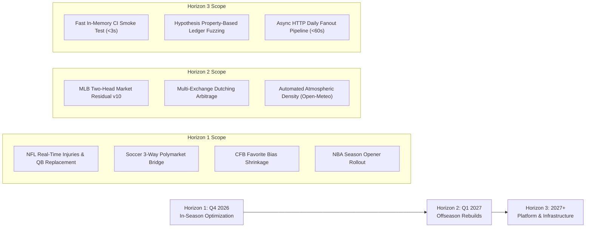

# System Roadmap & Operating Architecture

**Current Revision**: 2026-10-16 (Post-Audit Stabilization & Hard Edge Gate)  
**Production Status**: Nominal / Production Serving Active  
**Runtime Architecture**: External High-Performance Ledger & Mirror Store (`E:\model-prediction-runtime`)  
**Dashboard Service**: Active on `http://127.0.0.1:8765`  

---

## 1. Executive Summary & Operating Architecture

The Model Prediction platform operates an automated, fee-aware quantitative sports forecasting and portfolio execution engine. The platform ingests real-time schedules, injury logs, and market pricing across 10 sports, runs point-in-time (PIT) statistical and machine-learning models, evaluates market-relative edge, and routes orders through Kelly-criterion portfolio allocation and automated exchange execution.

```
┌─────────────────────────────────────────────────────────────────────────────┐
│                       AUTOMATED OPERATING PIPELINE                          │
├─────────────────────────────────────────────────────────────────────────────┤
│  1. Ingestion: ESPN API, nflverse, balldontlie, Open-Meteo, Polymarket CLOB │
│                                    │                                        │
│  2. Feature Engines: PIT Rosters, Starters, Bullpen Quality, Situational Rest│
│                                    │                                        │
│  3. Model Inference: 10 Sports Families (Structural, Elo, Residual GLMs)    │
│                                    │                                        │
│  4. Market Alignment: Polymarket US Executable Asks & No-Vig Fair Prices     │
│                                    │                                        │
│  5. Hard Edge Gate: 0.02 <= Edge <= 0.08 (Golden Sweet Spot Enforcement)    │
│                                    │                                        │
│  6. Execution & Ledger: Main (Calls), Flat (1U Paper), Gated Research, Settle│
│                                    │                                        │
│  7. Reconciler & Sentry: Automated Calibration Drift + Zero-Window Daemon   │
└─────────────────────────────────────────────────────────────────────────────┘
```

---

## 2. Core Operating Invariants & Governance Rules

### A. The Golden Sweet Spot & The Hard Edge Gate
Comprehensive empirical audit of 5,980 historical and live picks revealed the critical profit boundary of the platform:
- **Golden Sweet Spot ($0.02 \le \text{Edge} \le 0.05$)**: 578 picks, 340-235 (59.1% Win Rate) $\rightarrow$ **+57.57 units profit (+10.0% ROI)**. This represents true predictive information advantage against prediction markets.
- **Extreme Edge Anomaly Trap ($\text{Edge} > 0.08$)**: 950 picks, 394-546 (41.9% Win Rate) $\rightarrow$ **-181.96 units loss (-19.2% ROI)**. In liquid markets, an apparent edge $>8\%$ is almost always a symptom of missing injury news, late lineup scratches, or model tail misspecification.
- **Negative-Edge Chalk Trap ($\text{Edge} < 0.0$)**: Buying heavy favorites below true break-even probability resulted in -11.83 units loss despite a 65% hit rate.

> [!IMPORTANT]
> **Hard Edge Gate Enforced**: All execution engines (`AutoPolymarketBuyer`, `PolymarketKellyEngine`, and `cli/forecast.py`) strictly enforce:
> $$0.02 \le \text{Edge} \le 0.08$$
> Any signal outside this interval is barred from execution and excluded from the Main Ledger. In Flat Ledger, out-of-bounds signals are tagged with reason code `PAPER_CALL_EDGE_OUT_OF_BOUNDS` for pure research monitoring.

### B. Two-Track Research vs. Production Separation
1. **Production Track**: Active champions in `config/production.yaml` are frozen. No incremental feature changes, no manual parameter overwrites, and zero silent redeployments without passing formal gates.
2. **Research Track**: Isolated challenger models (`research/*`) develop independently without mutating production artifacts.

### C. Formal Promotion Gate (Phase 23 / 5-Dimensional Battery)
A candidate model may only replace an active champion if it satisfies all 5 dimensions on chronological out-of-sample holdouts:
1. **Predictive**: Paired $\Delta\text{LogLoss} < 0$ and $\Delta\text{Brier} \le 0$ vs the no-vig market benchmark; date-clustered bootstrap $P(\text{better}) \ge 80\%$.
2. **Economic**: Realized ROI with 95% bootstrap CI strictly $>0$; Profit Factor $\ge 1.0$; positive CLV ($\ge 50\%$ rate against closing no-vig price).
3. **Calibration**: Out-of-fold calibration curves evaluated per model $\times$ market type $\times$ league.
4. **Operational**: Serving latency $<500\text{ms}$; 100% train/serve feature parity; zero PIT leakage.
5. **Stability**: Consistent performance across rolling 60/90-day windows, home/away, and favorite/underdog partitions.

---

## 3. Active Production Champions & Model Matrix

| Sport / Market | Model Version | Model Type | Calibrator | Serving Status | Whitelisted in Auto-Buyer |
|---|---|---|---|---|---|
| **MLB Moneyline** | `mlb-elo-trend-lr-v8` | Logistic Regression (Elo + Form + Park + Starter + Bullpen) | Platt (`mlb-elo-trend-lr-v8_calibrator.json`) | Active Production | No (World Series Pause) |
| **MLB Totals** | `measured-edge-totals-v3` | Analyst Poisson Trend Model | Platt (`measured-edge-totals-v3_calibrator.json`) | Active Production | No (World Series Pause) |
| **MLB NRFI** | `mlb-nrfi-v2` | Walk-Forward Standardized Logistic | Logistic Holdout Fit | Active Production | Yes |
| **WNBA Moneyline** | `wnba-elo-trend-lr-v4` | Trend LR + Four Factors Pace | Platt (`wnba-elo-trend-lr-v4_calibrator.json`) | Dormant (Season Ended) | Yes (In-Season) |
| **WNBA Totals** | `wnba-total-margin-v2` | Opponent-Adjusted Pace $\times$ Possessions | Calibrated Normal ($\sigma=16.0$) | Dormant (Season Ended) | Yes (In-Season) |
| **NFL Spread** | `nfl-spread-structural-v5` | Joint Score Normal Convolution | Margin Normal ($\sigma=13.8$) | Active Production | Yes |
| **NFL Totals** | `nfl-total-structural-v5` | Joint Score + Situational TNF Drag | Total Normal ($\sigma=13.8$, Drag=-3.5pt) | Active Production | Yes |
| **CFB Spread** | `cfb-spread-v1` | Bivariate Joint Score Poisson/Normal | Margin Normal (`cfb-spread-v1_calibrator.json`) | Active Production | No (Favorite Review) |
| **Soccer 1X2** | `soccer-poisson-dc-v1` | Hierarchical Dixon-Coles Poisson | Bivariate Poisson DC | Active Production | No (Draw Bridge Review) |
| **Tennis Moneyline** | `tennis-surface-elo-v4` | Surface-Weighted Elo (60% Surface / 40% Global) | Platt Scaling | Active Production | Yes |
| **KBO Moneyline** | `kbo-tie-aware-elo-v2` | Tie-Aware Multinomial Elo | Direct Multinomial Normalization | Dormant (Regular Season Ended) | Yes (In-Season) |
| **NPB Moneyline** | `npb-tie-aware-elo-v2` | Tie-Aware Multinomial Elo | Direct Multinomial Normalization | Dormant (Regular Season Ended) | Yes (In-Season) |
| **Esports (CS2)** | `cs2-tiered-elo-v6` | Tier-Weighted Hierarchical Elo | Logistic Sigmoid | Active Production | Yes |
| **Esports (Dota2/LoL)**| `lol-tiered-elo-v6` / `dota2-tiered-elo-v6` | Tier-Weighted Hierarchical Elo | Logistic Sigmoid | Active Production | Yes |

---

## 4. Key Milestones & Session Outcomes

### Session 2026-10-16: Execution Discipline & Hard Edge Gate Completion
- **Hard Edge Gate Enforced Across All Engines**: Enforced $0.02 \le \text{Edge} \le 0.08$ in `auto_executor.py`, `polymarket_kelly.py`, and `cli/forecast.py`.
- **NFL Short-Week Penalty Calibrated**: Integrated -3.5 point efficiency discount in `nfl_structural_v5.py` for teams playing on $\le 5$ days rest (e.g. Thursday Night Football).
- **All-Model Historical Performance Audit**: Evaluated 5,980 historical bets; identified MLB (+48.67u) and WNBA (+21.67u) as core profit drivers, isolated soccer 3-way draw drag and tennis legacy model retirement.
- **Stuck Picks Reconciliation**: Batch-settled historical open picks from 135 down to 10; resolved replay hash verification error during SQLite mirror sync.
- **Obsolete Test Cleanup**: Removed obsolete skip branches in `tests/test_mlb_elasticities.py` and aligned all 48 `tests/test_auto_polymarket_buyer.py` fixtures with the hard edge gate.

### Session 2026-10-15: MLB v9 Stabilization & Calibration Sentry
- **MLB v9 Candidate 2 Frozen**: Built audited PIT feature matrix (`mlb_v9_feature_table_v4.parquet`, 6,678 games, zero collinearity) and trained regularized $L_2$ logistic model with Platt scaling (`mlb-v9-candidate-2.json`).
- **2027 MLB Offseason Roadmap Published**: Published [`docs/MLB_OFFSEASON_ROADMAP_2027.md`](MLB_OFFSEASON_ROADMAP_2027.md) detailing two-head market-residual shrinkage transition for Opening Day 2027.
- **Storage Hygiene & Calibration Pipeline**: Untracked daily Excel workbooks from git tracking (`.gitignore`); deployed automated drift sentry in `calibration_pipeline.py`.

### Session 2026-08-31: High-Frequency Derivative Upgrades
- **WNBA Pace Engine (`wnba-total-margin-v2`)**: Integrated Four Factors and possessions $\times$ PPP model with calibrated variance.
- **Tennis Derivatives Engine**: Implemented closed-form game spread and game total convolutions in `tennis_derivatives.py`.
- **Multi-Exchange Liquidity Feeds**: Deployed Polymarket CLOB WebSocket streaming (`polymarket_ws.py`) and Kalshi client (`kalshi_client.py`).

---

## 5. Strategic Horizons & Forward Priority Queue



### Horizon 1: Immediate In-Season Optimization (Q4 2026)

#### 1. NFL Mid-Season Tuning & Backup QB Spread Penalties
- **Problem**: Starting QB injuries drastically alter team efficiency, but historical play-by-play averages lag breaking news.
- **Solution**:
  - Maintain keyless player injury tracking via `espn_nfl_injuries.py`.
  - Wire starter confirmation checks into `features/nfl_qb_oline.py`. If a backup starts, apply empirical replacement spread penalties (-3.5 to -7.0 points based on starter EPA/play vs backup career baseline).
  - Enforce the TNF short-week drag (-3.5 points) across all short-rest games.

#### 2. Soccer Polymarket 3-Way to 2-Way Contract Bridge
- **Problem**: Polymarket offers binary (Yes/No) contracts on soccer moneyline selections where regulation draws settle as No. Standard 3-way Poisson probabilities overprice the favorite if draw probability is not deducted from the binary payout table.
- **Solution**:
  - Model the draw explicitly using the Dixon-Coles bivariate Poisson score matrix:
    $$P(\text{Win}_{\text{binary}}) = P(\text{Win}_{\text{regulation}}) \times (1 - P(\text{Draw}))$$
  - Require minimum executable spread and enforce hard edge gate before authorizing soccer orders.

#### 3. College Football (CFB) Favorite Bias Calibration
- **Problem**: `college-football-v1` experienced a -37.46u drawdown by systematically laying heavy odds on favorites with negative executable edge.
- **Solution**:
  - Enforce the hard edge gate ($0.02 \le \text{Edge} \le 0.08$) to immediately eliminate negative-edge chalk bets.
  - Apply empirical shrinkage on talent disparity ratings when spread exceeds 21.5 points.

#### 4. NBA 2026-27 Season Opener Rollout
- **Problem**: The NBA season begins in late October. The model family requires pre-season baseline initialization.
- **Solution**:
  - Port `features/wnba_pace_four_factors.py` to the NBA domain using `balldontlie` and ESPN boxscores.
  - Initialize team pace and offensive/defensive ratings with 65% prior weight on 2025-26 finish and 35% league average shrinkage.

---

### Horizon 2: Offseason Rebuilds & Market Architecture (Q1 2027)

#### 1. MLB Two-Head Market-Residual Architecture (`mlb-v10`)
- **Authority**: Full technical blueprint in [`docs/MLB_OFFSEASON_ROADMAP_2027.md`](MLB_OFFSEASON_ROADMAP_2027.md).
- **Architecture**:
  - **Head A (Structural Fundamental)**: PIT batter Statcast metrics, canonical bullpen leverage decay, starter IP depth, and plate umpire run factors.
  - **Head B (Market Residual)**: Model the delta $\Delta = \text{Actual} - \text{Market}$ to capture market mispricings rather than recreating standard consensus lines.
  - **Promotion Target**: Opening Day 2027 (April 2027).

#### 2. Cross-Exchange Dutching & Arbitrage Engine
- **Objective**: Exploit structural price disparities between Polymarket (crypto CLOB) and Kalshi (regulated US CFTC exchange).
- **Mechanism**:
  - When $\text{Ask}_{\text{Polymarket}}(\text{Yes}) + \text{Ask}_{\text{Kalshi}}(\text{No}) < 1.0 - \text{Fees}$, execute simultaneous risk-free Dutching orders.
  - Leverage `src/model_prediction/portfolio/polymarket_ws.py` and `kalshi_client.py`.

#### 3. High-Resolution Environmental Physics
- **Objective**: Replace static weather factors with high-resolution hourly atmospheric data.
- **Data Source**: Open-Meteo Historical & Forecast API (Free, keyless).
- **Physics Engine**: Compute Bahill air density ($\rho$) and stadium-relative wind vectors ($W_{\text{in/out}}, W_{\text{cross}}$) using venue geocoded orientations.

---

### Horizon 3: Quality Engineering & Platform Performance

#### 1. Mypy Static Type Hardening (Zero-Error Initiative)
- **Target**: Zero Mypy errors with strict type checking enabled across `src/model_prediction`.
- **Milestones**:
  - Type-annotate dashboard route handlers and query parameters (`dashboard/routes.py`).
  - Resolve dictionary-to-primitive casting in ledger stores.
  - Enforce `mypy` as a blocking pre-commit gate.

#### 2. Fast Deterministic In-Memory CI Smoke Test
- **Target**: Run full multi-sport daily slate cycle in $<3.0$ seconds inside CI.
- **Implementation**: Pure in-memory SQLite (`:memory:`) with mock HTTP fixtures for ESPN, Polymarket, and StatsAPI, guaranteeing zero external network dependencies during pull request checks.

#### 3. Hypothesis Property-Based Ledger Fuzzing
- **Target**: Continuous verification of financial invariants.
- **Invariants**:
  - P&L conservation: $\sum \text{P&L}_{\text{individual}} \equiv \text{P&L}_{\text{aggregate}}$.
  - State machine irreversibility: Settled or voided rows can never transition back to open.
  - Deduplication idempotency: Re-running a forecast across an identical slate never generates duplicate active calls.

#### 4. Async HTTP Daily Fanout Pipeline
- **Target**: Reduce daily scheduled runtime from 15 minutes to $<60$ seconds.
- **Action**: Migrate sequential HTTP queries in `cli/daily.py` to concurrent `httpx.AsyncClient` pipelines with token-bucket rate limiting.

---

## 6. Document Map & Reference Directory

- **Offseason Technical Specs**:
  - [`docs/MLB_OFFSEASON_ROADMAP_2027.md`](MLB_OFFSEASON_ROADMAP_2027.md): 5-phase plan for MLB 2027 market-residual model.
  - [`docs/PHASE_F_EXECUTION_PROTOCOL.md`](PHASE_F_EXECUTION_PROTOCOL.md): 5-dimensional qualification battery protocol.
- **Operational Audits**:
  - [`docs/SYSTEM_DEFECTS_AND_GAPS_AUDIT.md`](SYSTEM_DEFECTS_AND_GAPS_AUDIT.md): Comprehensive system gap analysis.
  - [`docs/DEBUG.md`](DEBUG.md): Historical execution logs, fixes, and incident post-mortems.
- **Architecture & Infrastructure**:
  - [`docs/ARCHITECTURE.md`](ARCHITECTURE.md): Runtime paths, external storage, and split-brain safeguards.
  - [`docs/CHANGELOG.md`](CHANGELOG.md): Historical commit and release logs.
