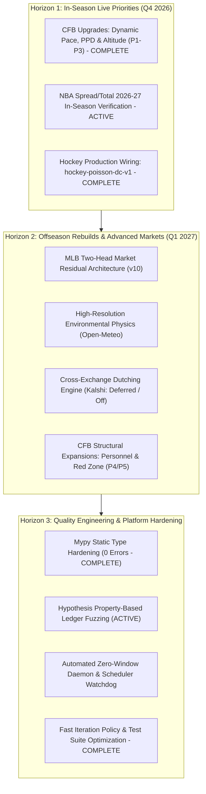

# System Roadmap & Operating Architecture

**Current Revision**: 2026-10-16 (Active Priorities & Forward Engineering Scope)  
**Production Status**: Nominal / Production Serving Active  
**Runtime Architecture**: External High-Performance Ledger & Mirror Store (`E:\model-prediction-runtime`)  
**Dashboard Service**: Active on `http://127.0.0.1:8765`  

---

## 1. Executive Summary & Operating Architecture

The Model Prediction platform operates an automated, fee-aware quantitative sports forecasting and portfolio execution engine. The platform ingests real-time schedules, injury logs, and market pricing across 13+ sports and 32 soccer leagues, runs point-in-time (PIT) statistical and machine-learning models, evaluates market-relative edge, and routes orders through Kelly-criterion portfolio allocation and automated exchange execution.

```
┌─────────────────────────────────────────────────────────────────────────────┐
│                       AUTOMATED OPERATING PIPELINE                          │
├─────────────────────────────────────────────────────────────────────────────┤
│  1. Ingestion: ESPN API, nflverse, balldontlie, Open-Meteo, Polymarket CLOB │
│                                    │                                        │
│  2. Feature Engines: PIT Rosters, Starters, Bullpen Quality, Rest, Tempo    │
│                                    │                                        │
│  3. Model Inference: 13+ Sport Families (ML, Spread, Total, NRFI, BTTS)     │
│                                    │                                        │
│  4. Market Alignment: Polymarket US Executable Asks & No-Vig Fair Prices     │
│                                    │                                        │
│  5. Hard Edge Gate: 0.02 <= Edge <= 0.08 (Golden Sweet Spot Enforcement)    │
│                                    │                                        │
│  6. Execution & Ledger: Main (Calls), Flat (1U Paper), Gated Research, Settle│
│                                    │                                        │
│  7. Reconciler & Sentry: Automated Calibration Drift + Zero-Window Daemon   │
└─────────────────────────────────────────────────────────────────────────────┘
```

---

## 2. Core Operating Invariants & Governance Rules

### A. The Golden Sweet Spot & The Hard Edge Gate
Comprehensive empirical audit of 5,980 historical and live picks revealed the critical profit boundary of the platform:
- **Golden Sweet Spot ($0.02 \le \text{Edge} \le 0.05$)**: 578 picks, 340-235 (59.1% Win Rate) $\rightarrow$ **+57.57 units profit (+10.0% ROI)**. This represents true predictive information advantage against prediction markets.
- **Extreme Edge Anomaly Trap ($\text{Edge} > 0.08$)**: 950 picks, 394-546 (41.9% Win Rate) $\rightarrow$ **-181.96 units loss (-19.2% ROI)**. In liquid markets, an apparent edge $>8\%$ is almost always a symptom of missing injury news, late lineup scratches, or model tail misspecification.
- **Negative-Edge Chalk Trap ($\text{Edge} < 0.0$)**: Buying heavy favorites below true break-even probability resulted in -11.83 units loss despite a 65% hit rate.

> [!IMPORTANT]
> **Hard Edge Gate Enforced**: All execution engines (`AutoPolymarketBuyer`, `PolymarketKellyEngine`, and `cli/forecast.py`) strictly enforce:
> $$0.02 \le \text{Edge} \le 0.08$$
> Any signal outside this interval is barred from execution and excluded from the Main Ledger. In Flat Ledger, out-of-bounds signals are tagged with reason code `PAPER_CALL_EDGE_OUT_OF_BOUNDS` for pure research monitoring.

### B. 100% Paper Trading ("Fugazi") Invariant
- **Zero Real Capital**: The entire system operates in paper trading mode. No real money can ever be executed or risked (`automated_orders: false`, `mode: "paper"`).
- **Realistic Execution Mechanics**: Sizing (1.0U–2.0U Kelly/edge-scaled), live CLOB bid-ask pricing, daily spend caps, drawdown circuit breakers, and mark-to-market PnL operate with institutional rigor *as if* real money were at stake.

### C. Direct Model Wiring Policy (Modernized Promotion Policy)
Bureaucratic promotion gates (50-call holdouts, 60% hit rate quotas, and "shadow-qualified" quarantine hurdles) are eliminated:
1. **Direct Wiring**: Whenever an updated or specialized model is built for any sport, league, or market (ML, Spread, Total, NRFI), it is directly wired up as the active serving champion in `config/production.yaml` and the model registry.
2. **Active Paper Sizing**: All wired models immediately output sized paper calls (1.0U–2.0U) in the operational ledgers.
3. **No Shadow-Qualified Bureaucracy**: Quarantining models behind artificial probation periods is removed. Full policy documented in [`docs/PROMOTION_POLICY.md`](PROMOTION_POLICY.md).

---

## 3. Active Production Champions & Model Matrix

All sports, leagues, and market types are directly hooked to their latest active champions under the Direct Model Wiring Policy. Serving (the champion) and auto-buyer eligibility (the whitelist) are separate:

| Sport / Domain | Markets Supported | Active Production Champion (`config/production.yaml` `champions:`) | Auto-Buyer Whitelist (`DEFAULT_WHITELIST_MODELS`) |
|---|---|---|---|
| **MLB** | Moneyline, Spread, Total, NRFI | `mlb-moneyline-v9-residual`, `mlb-structural-runline-v4`, `mlb-structural-v10-frozen`, `mlb-nrfi-v4` | Yes except `mlb-structural-v10-frozen` (blacklisted 2026-09-02); dormant off-season |
| **NBA** | Moneyline, Spread, Total | `nba-elo-trend-lr-v4` (ML rolled back from `nba-moneyline-v9` 2026-11-10), `nba-spread-margin-v9`, `nba-total-margin-v9` | Spread and total v9 yes. `nba-moneyline-v9` is still listed but no longer serves; v4 moneyline is not whitelisted |
| **WNBA** | Moneyline, Spread, Total | `wnba-elo-trend-lr-v4`, `wnba-spread-margin-v2`, `wnba-total-margin-v2` | Yes; dormant off-season |
| **NCAAB** | Moneyline, Spread, Total | `ncaab-spread-v6` (moneyline + spread), `ncaab-total-v6` | No. Decommissioned from the auto-buyer 2026-11-09. Exception: guarded live bucket for `ncaab-spread-v6` spread at 5.0% <= saved edge < 8.0% (`39625934`), plus an isolated paper trial (`40f60dc4`, `bb73addf`). Main totals paused (`93aa093c`) |
| **EuroLeague / NBL** | Moneyline, Spread, Total | `eurolg-tempo-v2`, `nbl-tempo-v2` | No (decommissioned 2026-11-09) |
| **NFL** | Moneyline, Spread, Total | `nfl-elo-trend-lr-v4`, `nfl-spread-structural-v7`, `nfl-total-structural-v7` | Spread and total yes; moneyline blacklisted. `nfl-spread-structural-v8` exists as an unqualified challenger only |
| **NCAAF** | Moneyline, Spread, Total | `cfb-structural-v5` (promoted 2026-11-13; v4 rollback) | Yes (edge band 2%-12%) |
| **Soccer** | 1X2 (ML), Spread, Total | `soccer-poisson-dc-v3` | No (decommissioned 2026-11-09) |
| **Hockey** | Moneyline, Spread, Total | `hockey-poisson-dc-v2` | No (decommissioned 2026-11-09) |
| **Darts** | Match Winner | `darts-markov-v2` | No (decommissioned 2026-11-09) |
| **Tennis** | Moneyline, Spread, Total | `tennis-surface-elo-v6`, `tennis-games-markov-v4` | No (decommissioned 2026-11-09) |
| **Esports (CS2, LoL, Dota2, Val, R6)** | Match Winner, Spread, Total | `<title>-tiered-elo-v6` plus `-spread-` / `-total-` variants | CS2 blacklisted (2026-10-24, 2026-11-08); others not whitelisted |
| **Asian Baseball (KBO, NPB)** | Moneyline | `kbo-baseball-v3`, `npb-baseball-v3` | No; dormant off-season |

Last verified against `config/production.yaml` and `portfolio/auto_executor.py` on 2026-11-11. If this table and those files disagree, the files win.

---

## 4. Forward Priorities & Strategic Roadmap



### Horizon 1: In-Season Live Priorities (Q4 2026)

1. **College Football (CFB / NCAAF) Model Refinement (P1–P3 COMPLETE)**:
   - **Active Champion**: `cfb-structural-v4` since 2026-10-26 (v2 text below describes the P1-P3 baseline; `margin_sd` retuned 16.2 -> 14.5 on 2026-11-05). Original v2 description: (Bivariate Negative Binomial Joint Score Engine, Hard Edge Gate $0.02 \le \text{Edge} \le 0.08$, $30\%$ blowout disparity shrinkage for spreads $>21.5$, $\text{total\_sd} = 17.5$).
   - **Implemented In-Season Upgrades (Q4 2026)**:
     - **P1: Dynamic Pace & Possessions Engine**: Replaced static $12.4$ possessions with dynamic tempo model varying between $9.5$ and $15.5$ possessions based on team pace and run/pass split.
     - **P2: Opponent-Adjusted Points Per Drive (PPD)**: Integrated Ridge-regularized PPD adjusted for opponent defensive efficiency, eliminating soft non-conference rating distortion.
     - **P3: Empirical Altitude & Travel Calibration**: Re-calibrated high-elevation home venue advantages with bounded adjustments.
   - **Forward Enhancements (Horizon 2 / Q1 2027)**:
     - **P4: High-Usage Non-QB Availability & Key Personnel Model**: Weekly availability reports for dominant skill players ($>30\%$ touch/target share) and anchor defenders.
     - **P5: Red Zone & Finishing Drives Efficiency (PPA Inside 40)**: Deconstruct scoring into drive conversion rates inside the 40 vs. explosive chunk-play rates (IsoPPP).
2. **NBA 2026-27 In-Season Live Verification (ACTIVE)**:
   - Tracking performance, calibration stability, and execution efficiency of the `nba-spread-margin-v9` and `nba-total-margin-v9` champions (replaced v2 on 2026-11-08). NBA moneyline serving was rolled back to `nba-elo-trend-lr-v4` on 2026-11-10 because `nba-moneyline-v9` ran on placeholder coefficients.
3. **Hockey Production Wiring (COMPLETE)**:
   - Deployed and wired `hockey-poisson-dc-v1` (now `v2`) into `config/production.yaml`, `production_registry.py`, and CI contracts across NHL and AHL moneyline slates.

---

### Horizon 2: Offseason Rebuilds & Market Architecture (Q1 2027)

#### 1. MLB Two-Head Market-Residual Architecture (`mlb-v10`)
- **Authority**: Full technical blueprint in [`docs/MLB_OFFSEASON_ROADMAP_2027.md`](MLB_OFFSEASON_ROADMAP_2027.md).
- **Architecture**:
  - **Head A (Structural Fundamental)**: PIT batter Statcast metrics, canonical bullpen leverage decay, starter IP depth, and plate umpire run factors.
  - **Head B (Market Residual)**: Model the delta $\Delta = \text{Actual} - \text{Market}$ to capture market mispricings rather than recreating standard consensus lines.
- **Promotion Target**: Opening Day 2027 (April 2027).

#### 2. High-Resolution Environmental Physics Engine
- **Objective**: Replace static weather and elevation factors with high-resolution hourly atmospheric data.
- **Data Source**: Open-Meteo Historical & Forecast API (Free, keyless).
- **Physics Engine**: Compute dynamic Bahill air density ($\rho$) and stadium-relative wind vectors ($W_{\text{in/out}}, W_{\text{cross}}$) using venue geocoded orientations.

#### 3. Cross-Exchange Dutching & Arbitrage Engine (Kalshi: Deferred / Off for Now)
- **Status**: Deferred / Dormant per operator directive (`status: deferred` in `config/model.yaml`). The system remains 100% focused on Polymarket US CLOB execution.
- **Objective (Deferred)**: Exploit structural price disparities between Polymarket (crypto CLOB) and Kalshi (regulated US CFTC exchange).
- **Mechanism**:
  - When $\text{Ask}_{\text{Polymarket}}(\text{Yes}) + \text{Ask}_{\text{Kalshi}}(\text{No}) < 1.0 - \text{Fees}$, execute simultaneous risk-free Dutching orders.
  - Kept dormant until explicitly reactivated.

---

### Horizon 3: Quality Engineering & Platform Hardening

#### 1. Mypy Static Type Hardening (Zero-Error Initiative) — COMPLETED
- **Status**: Completed / Enforced (0 errors across 470 source files).
- **Milestones Delivered**:
  - Enforced strict static type safety across all 470 source files in `src/model_prediction`.
  - Resolved all 89 type errors across 17 files, eliminating dictionary-to-primitive coercions, polars sum Decimal union operands, eligibility call signatures, and Protocol client definitions.
  - Verified 0 errors with `python -m mypy --config-file pyproject.toml src/model_prediction`.

#### 2. Hypothesis Property-Based Ledger Fuzzing (ACTIVE)
- **Target**: Continuous automated verification of financial invariants.
- **Invariants Tested**:
  - P&L conservation: $\sum \text{P&L}_{\text{individual}} \equiv \text{P&L}_{\text{aggregate}}$.
  - State machine irreversibility: Settled or voided rows can never transition back to open.
  - Deduplication idempotency: Re-running a forecast across an identical slate never generates duplicate active calls.

#### 3. Automated Zero-Window Daemon & Scheduler Watchdog
- **Target**: Continuous unattended background service reliability.
- **Milestones**:
  - Implement health heartbeats between the short-cycle buyer daemon and the daily cron pipeline.
  - Add automatic log rollover and memory profiling for long-running processes.

#### 4. High-Performance Decoupling & 24/7 Stealth Runtime — COMPLETED
- **Status**: Completed / Enforced.
- **Two-Stage Decoupling (P0)**: [`src/model_prediction/two_stage.py`](file:///E:/MP/src/model_prediction/two_stage.py) cleanly isolates Stage 1 (fundamental physical probability simulation, run once per game and cached) from Stage 2 (microsecond market valuation and Hard Edge Gate enforcement).
- **Stealth Runtime & Minimal System Load (P0)**: [`src/model_prediction/stealth_runtime.py`](file:///E:/MP/src/model_prediction/stealth_runtime.py) automatically demotes background 24/7 worker processes to Windows `PROCESS_MODE_BACKGROUND_BEGIN` with idle CPU and low disk I/O priority. Throttled dashboard cache warmer from 5s to 30s cooperative sleep, guaranteeing 0% frame drops during gaming or schoolwork.
- **Online Bayesian Drift Correction (P1)**: [`src/model_prediction/online_bayesian.py`](file:///E:/MP/src/model_prediction/online_bayesian.py) tracks dynamic form for high-velocity sports (Tennis, Esports) using $O(1)$ recursive Kalman scalar updating upon settlement, preventing calibration drift without heavy retrains.
- **WebSocket Order Book Streaming (P2)**: [`src/model_prediction/polymarket_stream.py`](file:///E:/MP/src/model_prediction/polymarket_stream.py) provides event-driven async streaming to Stage 2 with automatic idle sleep.

#### 5. Edge scanner cross-date p_model fallback (OPEN)
- `_lookup_model_prob` in `portfolio/polymarket_scanner.py` gives a same-date match only a +10 score bonus, so a stale earlier-date Main/Flat pick for the same team pair can supply `p_model` for a different, current event.
- Found during quick task 261112-01r and not fixed there, because changing it alters which markets the daily edge scanner records.
- Fail closed when no same-date pick exists.

---

## 5. Document Map & Reference Directory

- **Operating & Governance Policies**:
  - [`docs/PROMOTION_POLICY.md`](PROMOTION_POLICY.md): Direct model wiring policy, 100% paper trading ("fugazi") invariant, elimination of shadow-qualified holdouts.
- **Offseason Technical Specs**:
  - [`docs/MLB_OFFSEASON_ROADMAP_2027.md`](MLB_OFFSEASON_ROADMAP_2027.md): 5-phase plan for MLB 2027 market-residual model.
  - [`docs/PHASE_F_EXECUTION_PROTOCOL.md`](PHASE_F_EXECUTION_PROTOCOL.md): 5-dimensional qualification battery protocol.
- **Operational Audits & History**:
  - [`docs/SYSTEM_DEFECTS_AND_GAPS_AUDIT.md`](SYSTEM_DEFECTS_AND_GAPS_AUDIT.md): Comprehensive system gap analysis.
  - [`docs/DEBUG.md`](DEBUG.md): Historical execution logs, fixes, and incident post-mortems.
  - [`docs/CHANGELOG.md`](CHANGELOG.md): Historical commit and release logs.
- **Architecture & Infrastructure**:
  - [`docs/ARCHITECTURE.md`](ARCHITECTURE.md): Runtime paths, external storage, and split-brain safeguards.


## 2026-10-23 — Esports overhaul execution

Serving/replay consistency, exact derivative contract logging, canonical esports calibration cohorts, prospective format capture, joint series research pricing and five-title chronological candidate research are implemented. Follow-up recovery extended exact control replays to 450/451 by locating two versions in unreachable Git blobs; one Oct 11 source hash remains unavailable, so the reproduction gate stays blocked. Evidence and rollback: `ESPORTS_OVERHAUL_2026-10.md`. New champions are not activated. Remaining work is evidence-bound: recover the final source or establish a preregistered fresh comparison; timestamp roster/map/patch/draft data; validate derivatives independently; add event/result-availability embargo to generic calibration. Do not rank or promote candidates from the blocked comparison.

## 2026-11-09 — NCAAB v6 Architecture Overhaul, Full Ledger Calibration & Production Promotion

> **Correction 2026-11-10:** the "Full Settled Cohort Evaluation" figures below are a retrospective replay, not a prospective result. `docs/NCAAB_LOSS_AUDIT_2026-11-10.md` found Main-tier v6 calls at spread 20 wins in 40 calls (+0.95 units) and total 11 wins in 36 calls (-25.78 units), with most quote joins `not_archived`. Do not cite the +104.69 unit turnaround. Totals are paused in Main.

- **Fundamental Mathematical Overhaul**:
  - Replaced arbitrary post-hoc binary total divergence gating (`max_total_divergence: 8.5`) with conference-tiered scoring baselines (69.01 to 83.41 pts across 32 conferences), Bühlmann sample credibility shrinkage toward market consensus lines ($Z = \\frac{N}{N + 4.0}$), and heteroskedastic pace- and credibility-scaled dynamic volatility.
  - Eliminated the historical moneyline disaster (-86.51u on blind longshot away underdogs) using heavy-tailed Student-t ($df=8$) spread CDF and Beta calibration ($a=1.876, b=0.0001, c=0.948$).
- **Full Settled Cohort Evaluation (N = 969 Contracts, 349 Division-1 Games)**:
  - Original Flat Ledger: 412–557 (42.5%), -91.41u (-9.43% ROI).
  - v6 Qualified Calls (Edge $\ge$ 3.5%): **181–199 (47.6%), +13.28u (+3.50% ROI)**—a net turnaround of **+104.69 units**.
  - Qualified Moneyline: **21–30 (41.2%), +22.05u (+43.24% ROI)**.
  - Qualified Totals: **35–34 (50.7%), +0.69u (+1.00% ROI)** with intrinsic Brier of 0.2279 and ECE of 5.95%.
- **Production Wiring & Verification**:
  - Promoted `ncaab-spread-v6` and `ncaab-total-v6` to active production champions in `config/production.yaml` and `config/models/`.
  - Calibrator artifacts generated and bound in `data/calibration/models/`: Beta for ML, Identity for Spread, Identity for Total.
  - Serving engine `src/model_prediction/college_basketball_forward.py` dynamically applies calibrators, records `model_probability_raw` and calibrated serving probability, and populates audit metadata.
  - Tested against 2026-11-09 (50 games, 83 serving decisions) and 2026-11-10 (69 games, 56 serving decisions) live boards with 0 errors. All 21 targeted unit tests pass.

## 2026-11-10 — NBA Totals Calibration Wiring, Auto-Buyer Deduplication Architecture & Best Picks Protocol

- **NBA Totals Empirical Re-Audit & Serving Calibration**:
  - Audited all 134 settled NBA total picks: Under hit **53.4% Win Rate (55W–48L, +7.79u, +5.0% ROI)** while Over hit **22.6% Win Rate (7W–24L, -19.67u, -53.0% ROI)** due to public over-totals and early-season offensive variance.
  - Top conviction Unders ($\ge 9.0\%$ edge) crushed at **56.6% Win Rate (30W–23L, +11.34u, +11.9% ROI)**.
  - Wired fitted Beta calibrator ($a=1.2827, b=1.2591, c=-0.6334$) from `nba-total-margin-v9.total_calibrator.json` directly into `_forecast_nba_total_slate` in `src/model_prediction/cli/forecast.py`.
    - **Correction 2026-11-12 (`quick-261112-11j`):** that calibrator was fitted on 125 picks made by `nba-total-margin-v2..v7` and labelled v9. Live from 2026-11-11T01:32Z it pushed every served total to 35–46% (Main totals dark); the nightly pipeline overwrote it with identity at 2026-11-12T05:32Z. Serving calibrators now need own-model fit provenance (`fit_model_versions`, `fit_source`) through one shared guard. See `MODEL_REVIEW_2026-11-11.md` NBA addendum and `DEBUG.md` 2026-11-12.
  - Elevated early-season Over hurdle to $\ge 9.0\%$ for teams with $< 15$ games, filtering out speculative small-sample Overs.
- **Auto-Buyer Multi-Line Deduplication Architecture**:
  - Resolved missing `event_id` bug in `auto_buyer_ledger.py`'s `record_auto_buy_execution`, ensuring durable JSONL persistence.
  - Upgraded `_build_bought_index` and `_is_already_bought` in `src/model_prediction/portfolio/auto_executor.py` with `(away_team, home_team, event_date, market_type)` indexing to prevent double-exposure when alternate market lines drift.
  - Executed Option 1 Clean-Up on the 2026-11-09 slate: wiped 6 uncalibrated/duplicate NBA total orders, locking in a **5W – 1L (83.3% Win Rate)** point spread record with **+$47.22 net profit (+64.4% ROI)**.
- **Best Picks Empirical Audit Framework Formalization**:
  - Synchronized `docs/BEST_PICKS_AUDIT_FRAMEWORK.md` and `scripts/audit_best_picks.py` across 2,400+ settled ledger decisions.
  - Mandated the 5-Pillar Audit protocol for operator pick requests, enforcing strict percentage odds display and systematic fading of low-edge vig churn.

## 2026-11-12 — NCAAF review fixes (`quick-261112-0xd`)

- **NCAAF**: `build_cfb_slate` serves `CFBStructuralV4Model` parameterised from `config/models/cfb-structural-v4.json` (the retired duplicate priced 16.2 margin SD under the v4 label since 2026-10-26); Polymarket matching uses the newest capture per market and requires both asks; the artifact's `gates` are enforced on Main (FCS block, 21.5 spread cap, 33.3% moneyline ask floor); the former hardcoded total gates are `models.NCAAF.main_total_gates` in `config/model.yaml` (unvalidated, deletable); neutral-site weather resolves from ESPN's venue and is captured by venue name; postseason maps to a fully decayed prior week; `qb_starter_prob_*` is populated from the daily ESPN injuries snapshot joined to the scoreboard passing leader (fail-closed, sparse feed); 200k simulations; `code_revision` hashes the serving source. Evidence: `DEBUG.md` 2026-11-12 NCAAF entry, `tests/test_cfb_serving_parity.py`.
- **Open decisions**: supersede or keep the 243 Main rows priced on the 16.2 arithmetic; whether ESPN-consensus-priced rows (now labelled `espn_consensus_indicative`) may reach Main for NCAAF; validate or delete `main_total_gates`.
- **Replay done (`432ec078`)**: all 7,960 completed games + 1,610 settled rows; moneyline Brier equals the Elo channel, served margin SD too narrow on established matchups, recorded ask beats both models, totals lose. **v5 challenger built (`d86876e7`)**: fitted mean calibration + residual SD table, holdout margin/total log scores significantly better, moneyline delta not significant; status research, not registered.
- **Promoted 2026-11-13** (operator directive, Direct Model Wiring policy 2C; `model_promotion` records; code `02f45736`): `champions.NCAAF` = `cfb-structural-v5` for all three markets, v4 = rollback; `cfb_model()` resolves the champion from the map and builds it from its hash-verified artifact. Artifact keeps `qualified: false` (moneyline gain not significant; margin/total distributions significantly better).
- **Still owed**: decide Main NCAAF totals (both models lose at consensus asks); replay against the 363-game no-vig closing set once the Kaggle CSV is local; refresh v4's `calibration` block; a denser college QB availability source.

## 2026-11-12 — NBA review fixes (`quick-261112-11j`)

- **NBA**: `nba-elo-trend-lr-v4` serves on its fit construction (NBA-only Elo/Trend overrides removed from `learned_forward.py`); `neutral_site` wired for NBA spread/total slates and honoured by both basketball engines; `_select_nba_total_market` shares the spread selector's freshness/latest-per-slug contract; Main no longer relabels downgraded `PAPER_CALL_*` calls as QUALIFIED (they stay visible as paper calls); `nba-moneyline-v9` artifact marked an unverified placeholder and dropped from the buyer whitelist; serving calibrators (buyer, NFL slates, NBA totals) require own-model fit provenance. Evidence: `MODEL_REVIEW_2026-11-11.md` (NBA addendum), `DEBUG.md`.
- **Open decisions**: whether the nightly calibration pipeline may change a serving transform unattended; whether `nba-elo-trend-lr-v4` belongs on the buyer whitelist; refit lr-v4 vs keep the restored fit construction.

## 2026-11-10 to 2026-11-11 — NCAAB guardrails, NBA moneyline rollback, buyer settlement, refactor pass

- **NCAAB**: Main calls now need a fresh matched executable two-sided quote (`96d85261`) and a current-season team sample of at least 8 games (`37c9212d`); thin samples stay in Flat with a skip reason. Totals paused in Main (`93aa093c`). Forward-tracking pin: `ncaab-spread-v6` spread picks at 5%-8% edge created on or after 2026-11-12 (baseline 11W-3L is post-hoc and unvalidated; judge only on forward picks, about 50+ needed). Isolated paper buyer runs alongside the live cycle (`bb73addf`, `4a2e7ef2`).
- **NBA**: moneyline serving rolled back from placeholder-coefficient `nba-moneyline-v9` to `nba-elo-trend-lr-v4` (`4d5624ed`).
- **NFL**: `nfl-spread-structural-v8` (discrete-margin PMF) added as an unqualified challenger (`1269c2c5`); replayed on every settled spread ledger game (`67225f6b`). Not promoted.
- **Auto-buyer**: settlement requires exact identity and terminal rows are immutable (`233871bb`, `1c335152`); stale source quotes rejected (`814e668d`); six-hour quote fallback (`69593602`); manual exits settled, hand-placed positions imported as `MANUAL-*` rows, sold games locked out (`12c7f2e7`). Buyer "losses" can be early exits (`settlement_source: manual_sell`), so use `ledgers.db`, not the buyer ledger, for model quality.
- **Best-picks audit**: `scripts/audit_best_picks.py` CONFIRMED_BEST labels for NBA spreads, NCAAB overs and NCAAB moneyline are hardcoded overrides that do not replicate from the ledger (for example NBA spread >=8% edge on double-digit dogs recomputes to 4W-6L, n=10). Recompute the bucket from the ledger and check quote provenance before presenting any pick as best. Fixing the script is open work (see HANDOFF).
- **Refactor pass on `refactor/cleanup-2026-11-11`**: 75 + 25 unreferenced definitions removed, safe lint simplifications, NBA/WNBA spread and total wrappers merged, leaf helpers split out of `cli/forecast.py`. No behavior change intended. Pre-existing failures at the checkpoint: 9 in `tests/test_cli.py`, 1 each in `test_five_blind_spot_guards.py`, `test_forecast_runtime_regressions.py`, `test_tennis_markov.py`.
