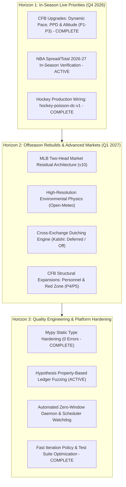

# System Roadmap & Operating Architecture

**Current Revision**: 2026-10-16 (Active Priorities & Forward Engineering Scope)  
**Production Status**: Nominal / Production Serving Active  
**Runtime Architecture**: External High-Performance Ledger & Mirror Store (`E:\model-prediction-runtime`)  
**Dashboard Service**: Active on `http://127.0.0.1:8765`  

---

## 1. Executive Summary & Operating Architecture

The Model Prediction platform operates an automated, fee-aware quantitative sports forecasting and portfolio execution engine. The platform ingests real-time schedules, injury logs, and market pricing across 13+ sports and 32 soccer leagues, runs point-in-time (PIT) statistical and machine-learning models, evaluates market-relative edge, and routes orders through Kelly-criterion portfolio allocation and automated exchange execution.

```
┌─────────────────────────────────────────────────────────────────────────────┐
│                       AUTOMATED OPERATING PIPELINE                          │
├─────────────────────────────────────────────────────────────────────────────┤
│  1. Ingestion: ESPN API, nflverse, balldontlie, Open-Meteo, Polymarket CLOB │
│                                    │                                        │
│  2. Feature Engines: PIT Rosters, Starters, Bullpen Quality, Rest, Tempo    │
│                                    │                                        │
│  3. Model Inference: 13+ Sport Families (ML, Spread, Total, NRFI, BTTS)     │
│                                    │                                        │
│  4. Market Alignment: Polymarket US Executable Asks & No-Vig Fair Prices     │
│                                    │                                        │
│  5. Hard Edge Gate: 0.02 <= Edge <= 0.08 (Golden Sweet Spot Enforcement)    │
│                                    │                                        │
│  6. Execution & Ledger: Main (Calls), Flat (1U Paper), Gated Research, Settle│
│                                    │                                        │
│  7. Reconciler & Sentry: Automated Calibration Drift + Zero-Window Daemon   │
└─────────────────────────────────────────────────────────────────────────────┘
```

---

## 2. Core Operating Invariants & Governance Rules

### A. The Golden Sweet Spot & The Hard Edge Gate
Comprehensive empirical audit of 5,980 historical and live picks revealed the critical profit boundary of the platform:
- **Golden Sweet Spot ($0.02 \le \text{Edge} \le 0.05$)**: 578 picks, 340-235 (59.1% Win Rate) $\rightarrow$ **+57.57 units profit (+10.0% ROI)**. This represents true predictive information advantage against prediction markets.
- **Extreme Edge Anomaly Trap ($\text{Edge} > 0.08$)**: 950 picks, 394-546 (41.9% Win Rate) $\rightarrow$ **-181.96 units loss (-19.2% ROI)**. In liquid markets, an apparent edge $>8\%$ is almost always a symptom of missing injury news, late lineup scratches, or model tail misspecification.
- **Negative-Edge Chalk Trap ($\text{Edge} < 0.0$)**: Buying heavy favorites below true break-even probability resulted in -11.83 units loss despite a 65% hit rate.

> [!IMPORTANT]
> **Hard Edge Gate Enforced**: All execution engines (`AutoPolymarketBuyer`, `PolymarketKellyEngine`, and `cli/forecast.py`) strictly enforce:
> $$0.02 \le \text{Edge} \le 0.08$$
> Any signal outside this interval is barred from execution and excluded from the Main Ledger. In Flat Ledger, out-of-bounds signals are tagged with reason code `PAPER_CALL_EDGE_OUT_OF_BOUNDS` for pure research monitoring.

### B. 100% Paper Trading ("Fugazi") Invariant
- **Zero Real Capital**: The entire system operates in paper trading mode. No real money can ever be executed or risked (`automated_orders: false`, `mode: "paper"`).
- **Realistic Execution Mechanics**: Sizing (1.0U–2.0U Kelly/edge-scaled), live CLOB bid-ask pricing, daily spend caps, drawdown circuit breakers, and mark-to-market PnL operate with institutional rigor *as if* real money were at stake.

### C. Direct Model Wiring Policy (Modernized Promotion Policy)
Bureaucratic promotion gates (50-call holdouts, 60% hit rate quotas, and "shadow-qualified" quarantine hurdles) are eliminated:
1. **Direct Wiring**: Whenever an updated or specialized model is built for any sport, league, or market (ML, Spread, Total, NRFI), it is directly wired up as the active serving champion in `config/production.yaml` and the model registry.
2. **Active Paper Sizing**: All wired models immediately output sized paper calls (1.0U–2.0U) in the operational ledgers.
3. **No Shadow-Qualified Bureaucracy**: Quarantining models behind artificial probation periods is removed. Full policy documented in [`docs/PROMOTION_POLICY.md`](PROMOTION_POLICY.md).

---

## 3. Active Production Champions & Model Matrix

All sports, leagues, and market types are directly hooked to their latest active champions under the Direct Model Wiring Policy:

| Sport / Domain | Markets Supported | Active Production Champion | Model Engine Type | Serving Status | Whitelisted in Auto-Buyer |
|---|---|---|---|---|---|
| **MLB** | Moneyline, Spread, Total, NRFI | `mlb-elo-trend-lr-v8`, `measured-edge-margin-v3`, `measured-edge-totals-v3`, `mlb-nrfi-v4` | Logistic Regression (Elo + Form + Park + Starter + Bullpen) + Poisson | Active Production | No (World Series Pause) |
| **NBA** | Moneyline, Spread, Total | `nba-elo-trend-lr-v4`, `nba-spread-margin-v2`, `nba-total-margin-v2` | Elo Trend LR + Calibrated Normal Margin/Total Engines (Holdout MAE 11.470) | Active Production | Yes (Season Opening) |
| **WNBA** | Moneyline, Spread, Total | `wnba-elo-trend-lr-v4`, `wnba-spread-margin-v2`, `wnba-total-margin-v2` | Trend LR + Four Factors Pace & Possessions Model | Dormant (Season Ended) | Yes (In-Season) |
| **Basketball Expansion** | Moneyline, Spread, Total | `ncaab-tempo-v1`, `wncaab-tempo-v1`, `euroleague-tempo-v1` | Tempo-Adjusted Normal Models (NCAAB, WNCAAB, EuroLeague) | Active Production | Yes |
| **NFL** | Moneyline, Spread, Total | `nfl-elo-trend-lr-v4`, `nfl-spread-structural-v5`, `nfl-total-structural-v5` | Joint Score Normal Convolution + QB Injury Pipeline + TNF Rest Drag | Active Production (Predictively Qualified) | Yes |
| **CFB (NCAAF)** | Moneyline, Spread, Total | `cfb-structural-v2` | Bivariate Negative Binomial Joint Score Engine + Blowout Shrinkage (>21.5) | Active Production | Yes (Chalk Shrinkage) |
| **Soccer (32 Leagues)** | 1X2 (ML), Spread, Total, BTTS | `soccer-poisson-dc-v2` + dedicated league parameters | Hierarchical Dixon-Coles Bivariate Poisson (Dedicated League Models) | Active Production | Yes |
| **Hockey (NHL, AHL)** | Moneyline, Spread, Total | `hockey-poisson-dc-v1` | Bivariate Poisson with OT / Shootout Normalization | Active Production | Yes |
| **Darts (PDC, MODUS)** | Match Winner, Spread, Total | `darts-markov-v1` | Exact Markov Leg-Progression Dynamic Programming | Active Production | Yes |
| **Tennis (ATP, WTA)** | Moneyline, Spread, Total | `tennis-surface-elo-v4` | Surface-Weighted Elo (60% Surface / 40% Global) + Markov Chain | Active Production | Yes |
| **Esports (CS2, LoL, Dota2, Val, R6)** | Match Winner, Spread, Total | `cs2-tiered-elo-v6`, `lol-tiered-elo-v6`, `dota2-tiered-elo-v6`, `valorant-tiered-elo-v6`, `rainbow_six-tiered-elo-v6` | Tier-Weighted Neutral Hierarchical Elo + Map Distributions | Active Production | Yes |
| **Asian Baseball (KBO, NPB)** | Moneyline, Spread, Total | `kbo-tie-aware-elo-v2`, `npb-tie-aware-elo-v2` | Tie-Aware Multinomial Elo + Run Difference Convolutions | Dormant (Season Ended) | Yes (In-Season) |

---

## 4. Forward Priorities & Strategic Roadmap



### Horizon 1: In-Season Live Priorities (Q4 2026)

1. **College Football (CFB / NCAAF) Model Refinement (P1–P3 COMPLETE)**:
   - **Active Champion**: `cfb-structural-v2` (Bivariate Negative Binomial Joint Score Engine, Hard Edge Gate $0.02 \le \text{Edge} \le 0.08$, $30\%$ blowout disparity shrinkage for spreads $>21.5$, $\text{total\_sd} = 17.5$).
   - **Implemented In-Season Upgrades (Q4 2026)**:
     - **P1: Dynamic Pace & Possessions Engine**: Replaced static $12.4$ possessions with dynamic tempo model varying between $9.5$ and $15.5$ possessions based on team pace and run/pass split.
     - **P2: Opponent-Adjusted Points Per Drive (PPD)**: Integrated Ridge-regularized PPD adjusted for opponent defensive efficiency, eliminating soft non-conference rating distortion.
     - **P3: Empirical Altitude & Travel Calibration**: Re-calibrated high-elevation home venue advantages with bounded adjustments.
   - **Forward Enhancements (Horizon 2 / Q1 2027)**:
     - **P4: High-Usage Non-QB Availability & Key Personnel Model**: Weekly availability reports for dominant skill players ($>30\%$ touch/target share) and anchor defenders.
     - **P5: Red Zone & Finishing Drives Efficiency (PPA Inside 40)**: Deconstruct scoring into drive conversion rates inside the 40 vs. explosive chunk-play rates (IsoPPP).
2. **NBA 2026-27 In-Season Live Verification (ACTIVE)**:
   - Tracking performance, calibration stability, and execution efficiency of newly deployed `nba-spread-margin-v2` (holdout MAE 11.470) and `nba-total-margin-v2` across the opening 100 games of the 2026-27 regular season.
3. **Hockey Production Wiring (COMPLETE)**:
   - Deployed and wired `hockey-poisson-dc-v1` into `config/production.yaml`, `production_registry.py`, and CI contracts across NHL and AHL moneyline slates.

---

### Horizon 2: Offseason Rebuilds & Market Architecture (Q1 2027)

#### 1. MLB Two-Head Market-Residual Architecture (`mlb-v10`)
- **Authority**: Full technical blueprint in [`docs/MLB_OFFSEASON_ROADMAP_2027.md`](MLB_OFFSEASON_ROADMAP_2027.md).
- **Architecture**:
  - **Head A (Structural Fundamental)**: PIT batter Statcast metrics, canonical bullpen leverage decay, starter IP depth, and plate umpire run factors.
  - **Head B (Market Residual)**: Model the delta $\Delta = \text{Actual} - \text{Market}$ to capture market mispricings rather than recreating standard consensus lines.
- **Promotion Target**: Opening Day 2027 (April 2027).

#### 2. High-Resolution Environmental Physics Engine
- **Objective**: Replace static weather and elevation factors with high-resolution hourly atmospheric data.
- **Data Source**: Open-Meteo Historical & Forecast API (Free, keyless).
- **Physics Engine**: Compute dynamic Bahill air density ($\rho$) and stadium-relative wind vectors ($W_{\text{in/out}}, W_{\text{cross}}$) using venue geocoded orientations.

#### 3. Cross-Exchange Dutching & Arbitrage Engine (Kalshi: Deferred / Off for Now)
- **Status**: Deferred / Dormant per operator directive (`status: deferred` in `config/model.yaml`). The system remains 100% focused on Polymarket US CLOB execution.
- **Objective (Deferred)**: Exploit structural price disparities between Polymarket (crypto CLOB) and Kalshi (regulated US CFTC exchange).
- **Mechanism**:
  - When $\text{Ask}_{\text{Polymarket}}(\text{Yes}) + \text{Ask}_{\text{Kalshi}}(\text{No}) < 1.0 - \text{Fees}$, execute simultaneous risk-free Dutching orders.
  - Kept dormant until explicitly reactivated.

---

### Horizon 3: Quality Engineering & Platform Hardening

#### 1. Mypy Static Type Hardening (Zero-Error Initiative) — COMPLETED
- **Status**: Completed / Enforced (0 errors across 470 source files).
- **Milestones Delivered**:
  - Enforced strict static type safety across all 470 source files in `src/model_prediction`.
  - Resolved all 89 type errors across 17 files, eliminating dictionary-to-primitive coercions, polars sum Decimal union operands, eligibility call signatures, and Protocol client definitions.
  - Verified 0 errors with `python -m mypy --config-file pyproject.toml src/model_prediction`.

#### 2. Hypothesis Property-Based Ledger Fuzzing (ACTIVE)
- **Target**: Continuous automated verification of financial invariants.
- **Invariants Tested**:
  - P&L conservation: $\sum \text{P&L}_{\text{individual}} \equiv \text{P&L}_{\text{aggregate}}$.
  - State machine irreversibility: Settled or voided rows can never transition back to open.
  - Deduplication idempotency: Re-running a forecast across an identical slate never generates duplicate active calls.

#### 3. Automated Zero-Window Daemon & Scheduler Watchdog
- **Target**: Continuous unattended background service reliability.
- **Milestones**:
  - Implement health heartbeats between the short-cycle buyer daemon and the daily cron pipeline.
  - Add automatic log rollover and memory profiling for long-running processes.

---

## 5. Document Map & Reference Directory

- **Operating & Governance Policies**:
  - [`docs/PROMOTION_POLICY.md`](PROMOTION_POLICY.md): Direct model wiring policy, 100% paper trading ("fugazi") invariant, elimination of shadow-qualified holdouts.
- **Offseason Technical Specs**:
  - [`docs/MLB_OFFSEASON_ROADMAP_2027.md`](MLB_OFFSEASON_ROADMAP_2027.md): 5-phase plan for MLB 2027 market-residual model.
  - [`docs/PHASE_F_EXECUTION_PROTOCOL.md`](PHASE_F_EXECUTION_PROTOCOL.md): 5-dimensional qualification battery protocol.
- **Operational Audits & History**:
  - [`docs/SYSTEM_DEFECTS_AND_GAPS_AUDIT.md`](SYSTEM_DEFECTS_AND_GAPS_AUDIT.md): Comprehensive system gap analysis.
  - [`docs/DEBUG.md`](DEBUG.md): Historical execution logs, fixes, and incident post-mortems.
  - [`docs/CHANGELOG.md`](CHANGELOG.md): Historical commit and release logs.
- **Architecture & Infrastructure**:
  - [`docs/ARCHITECTURE.md`](ARCHITECTURE.md): Runtime paths, external storage, and split-brain safeguards.
