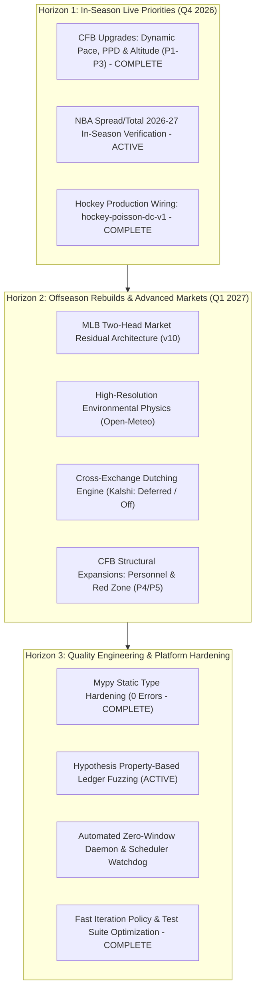

# System Roadmap & Operating Architecture

**Current Revision**: 2026-10-16 (Active Priorities & Forward Engineering Scope)  
**Production Status**: Nominal / Production Serving Active  
**Runtime Architecture**: External High-Performance Ledger & Mirror Store (`E:\model-prediction-runtime`)  
**Dashboard Service**: Active on `http://127.0.0.1:8765`  

---

## 1. Executive Summary & Operating Architecture

The Model Prediction platform operates an automated, fee-aware quantitative sports forecasting and portfolio execution engine. The platform ingests real-time schedules, injury logs, and market pricing across 13+ sports and 32 soccer leagues, runs point-in-time (PIT) statistical and machine-learning models, evaluates market-relative edge, and routes orders through Kelly-criterion portfolio allocation and automated exchange execution.

```
┌─────────────────────────────────────────────────────────────────────────────┐
│                       AUTOMATED OPERATING PIPELINE                          │
├─────────────────────────────────────────────────────────────────────────────┤
│  1. Ingestion: ESPN API, nflverse, balldontlie, Open-Meteo, Polymarket CLOB │
│                                    │                                        │
│  2. Feature Engines: PIT Rosters, Starters, Bullpen Quality, Rest, Tempo    │
│                                    │                                        │
│  3. Model Inference: 13+ Sport Families (ML, Spread, Total, NRFI, BTTS)     │
│                                    │                                        │
│  4. Market Alignment: Polymarket US Executable Asks & No-Vig Fair Prices     │
│                                    │                                        │
│  5. Hard Edge Gate: 0.02 <= Edge <= 0.08 (Golden Sweet Spot Enforcement)    │
│                                    │                                        │
│  6. Execution & Ledger: Main (Calls), Flat (1U Paper), Gated Research, Settle│
│                                    │                                        │
│  7. Reconciler & Sentry: Automated Calibration Drift + Zero-Window Daemon   │
└─────────────────────────────────────────────────────────────────────────────┘
```

---

## 2. Core Operating Invariants & Governance Rules

### A. The Golden Sweet Spot & The Hard Edge Gate
Comprehensive empirical audit of 5,980 historical and live picks revealed the critical profit boundary of the platform:
- **Golden Sweet Spot ($0.02 \le \text{Edge} \le 0.05$)**: 578 picks, 340-235 (59.1% Win Rate) $\rightarrow$ **+57.57 units profit (+10.0% ROI)**. This represents true predictive information advantage against prediction markets.
- **Extreme Edge Anomaly Trap ($\text{Edge} > 0.08$)**: 950 picks, 394-546 (41.9% Win Rate) $\rightarrow$ **-181.96 units loss (-19.2% ROI)**. In liquid markets, an apparent edge $>8\%$ is almost always a symptom of missing injury news, late lineup scratches, or model tail misspecification.
- **Negative-Edge Chalk Trap ($\text{Edge} < 0.0$)**: Buying heavy favorites below true break-even probability resulted in -11.83 units loss despite a 65% hit rate.

> [!IMPORTANT]
> **Hard Edge Gate Enforced**: All execution engines (`AutoPolymarketBuyer`, `PolymarketKellyEngine`, and `cli/forecast.py`) strictly enforce:
> $$0.02 \le \text{Edge} \le 0.08$$
> Any signal outside this interval is barred from execution and excluded from the Main Ledger. In Flat Ledger, out-of-bounds signals are tagged with reason code `PAPER_CALL_EDGE_OUT_OF_BOUNDS` for pure research monitoring.

### B. 100% Paper Trading ("Fugazi") Invariant
- **Zero Real Capital**: The entire system operates in paper trading mode. No real money can ever be executed or risked (`automated_orders: false`, `mode: "paper"`).
- **Realistic Execution Mechanics**: Sizing (1.0U–2.0U Kelly/edge-scaled), live CLOB bid-ask pricing, daily spend caps, drawdown circuit breakers, and mark-to-market PnL operate with institutional rigor *as if* real money were at stake.

### C. Direct Model Wiring Policy (Modernized Promotion Policy)
Bureaucratic promotion gates (50-call holdouts, 60% hit rate quotas, and "shadow-qualified" quarantine hurdles) are eliminated:
1. **Direct Wiring**: Whenever an updated or specialized model is built for any sport, league, or market (ML, Spread, Total, NRFI), it is directly wired up as the active serving champion in `config/production.yaml` and the model registry.
2. **Active Paper Sizing**: All wired models immediately output sized paper calls (1.0U–2.0U) in the operational ledgers.
3. **No Shadow-Qualified Bureaucracy**: Quarantining models behind artificial probation periods is removed. Full policy documented in [`docs/PROMOTION_POLICY.md`](PROMOTION_POLICY.md).

---

## 3. Active Production Champions & Model Matrix

All sports, leagues, and market types are directly hooked to their latest active champions under the Direct Model Wiring Policy. Serving (the champion) and auto-buyer eligibility (the whitelist) are separate:

| Sport / Domain | Markets Supported | Active Production Champion (`config/production.yaml` `champions:`) | Auto-Buyer Whitelist (`DEFAULT_WHITELIST_MODELS`) |
|---|---|---|---|
| **MLB** | Moneyline, Spread, Total, NRFI | `mlb-moneyline-v9-residual`, `mlb-structural-runline-v4`, `mlb-structural-v10-frozen`, `mlb-nrfi-v4` | Yes except `mlb-structural-v10-frozen` (blacklisted 2026-09-02); dormant off-season |
| **NBA** | Moneyline, Spread, Total | `nba-elo-trend-lr-v5` (ML champion since 2026-11-13, `ec3210a2`; v4 is rollback), `nba-spread-margin-v9`, `nba-total-margin-v9.2` (bias-fixed v9.1 engine with an honest shrink, promoted 2026-11-23; v9 rollback) | Spread and total v9 yes. `nba-moneyline-v9` is still listed but no longer serves; v4 moneyline is not whitelisted |
| **WNBA** | Moneyline, Spread, Total | `wnba-elo-trend-lr-v4`, `wnba-spread-margin-v2`, `wnba-total-margin-v2` | Yes; dormant off-season |
| **NCAAB** | Moneyline, Spread, Total | `ncaab-spread-v6` (moneyline + spread), `ncaab-total-v6` | No. Decommissioned from the auto-buyer 2026-11-09. The 2026-11-10 `ncaab-spread-v6` live bucket (`39625934`) was removed 2026-11-26 (`3767c9ff`); live NCAAB buying is the operator cohorts in the state's `cohorts` list (spread v7, total v6; paper twins, see the auto-buyer section), plus an isolated paper trial (`40f60dc4`, `bb73addf`). Main totals paused (`93aa093c`) |
| **EuroLeague / NBL** | Moneyline, Spread, Total | `eurolg-tempo-v2`, `nbl-tempo-v2` | No (decommissioned 2026-11-09) |
| **NFL** | Moneyline, Spread, Total | `nfl-elo-trend-lr-v4`, `nfl-spread-structural-v7.2` (v7 cover probability shrunk, slope fitted on validation by operator exception, 2026-11-23), `nfl-total-structural-v7.1` (v7 with the over probability shrunk, promoted 2026-11-23; v7 rollback) | Spread and total yes; moneyline blacklisted. `nfl-spread-structural-v8` exists as an unqualified challenger only |
| **NCAAF** | Moneyline, Spread, Total | `cfb-structural-v5.2` (v5 with totals shrunk to ~50%, promoted 2026-11-23; v5 rollback). Next: v7.1 champion path (docs/handoffs/HANDOFF.md section 6) | Yes (edge band 2%-12%); totals effectively no longer fire |
| **Soccer** | 1X2 (ML), Spread, Total | `soccer-poisson-dc-v3` | No (decommissioned 2026-11-09) |
| **Hockey** | Moneyline, Spread, Total | `hockey-poisson-dc-v2` | No (decommissioned 2026-11-09) |
| **Darts** | Match Winner | `darts-markov-v2` | No (decommissioned 2026-11-09) |
| **Tennis** | Moneyline, Spread, Total | `tennis-surface-elo-v6`, `tennis-games-markov-v4` | No (decommissioned 2026-11-09) |
| **Esports (CS2, LoL, Dota2, Val, R6)** | Match Winner, Spread, Total | `<title>-tiered-elo-v6` plus `-spread-` / `-total-` variants | CS2 blacklisted (2026-10-24, 2026-11-08); others not whitelisted |
| **Asian Baseball (KBO, NPB)** | Moneyline | `kbo-baseball-v3`, `npb-baseball-v3` | No; dormant off-season |

Last verified against `config/production.yaml` and `portfolio/auto_executor.py` on 2026-11-11. If this table and those files disagree, the files win.

---

## 4. Forward Priorities & Strategic Roadmap



### Horizon 1: In-Season Live Priorities (Q4 2026)

1. **College Football (CFB / NCAAF) Model Refinement (P1–P3 COMPLETE)**:
   - **Active Champion**: `cfb-structural-v4` since 2026-10-26 (v2 text below describes the P1-P3 baseline; `margin_sd` retuned 16.2 -> 14.5 on 2026-11-05). Original v2 description: (Bivariate Negative Binomial Joint Score Engine, Hard Edge Gate $0.02 \le \text{Edge} \le 0.08$, $30\%$ blowout disparity shrinkage for spreads $>21.5$, $\text{total\_sd} = 17.5$).
   - **Implemented In-Season Upgrades (Q4 2026)**:
     - **P1: Dynamic Pace & Possessions Engine**: Replaced static $12.4$ possessions with dynamic tempo model varying between $9.5$ and $15.5$ possessions based on team pace and run/pass split.
     - **P2: Opponent-Adjusted Points Per Drive (PPD)**: Integrated Ridge-regularized PPD adjusted for opponent defensive efficiency, eliminating soft non-conference rating distortion.
     - **P3: Empirical Altitude & Travel Calibration**: Re-calibrated high-elevation home venue advantages with bounded adjustments.
   - **Forward Enhancements (Horizon 2 / Q1 2027)**:
     - **P4: High-Usage Non-QB Availability & Key Personnel Model**: Weekly availability reports for dominant skill players ($>30\%$ touch/target share) and anchor defenders.
     - **P5: Red Zone & Finishing Drives Efficiency (PPA Inside 40)**: Deconstruct scoring into drive conversion rates inside the 40 vs. explosive chunk-play rates (IsoPPP).
   - **Open items from the 2026-11-15 v6 challenger (`quick-261114-srb`, follow-up `quick-261115-0pq`)**: `cfb-structural-v6` (shadow only, not routed) is better calibrated than v5 on the locked holdout (Brier 0.17975 vs 0.19003) but shows no market-relative edge against ESPN closing lines (holdout-window correlation with the line: totals -0.008, spreads +0.019, intervals include zero), and the market-anchored residual test returned NO PICK. The known-team gate and the checkout-proof lib pin shipped on 2026-11-15. Still open: (1) `groups=80/81` in the NCAAF scoreboard ingest plus a live-history backfill was measured and REJECTED by a pre-pinned rule (v5 holdout Brier 0.18933 to 0.19040, delta +0.001065 against a +0.001 limit; log scores improve by +0.0030 margin and +0.0042 total; 1,478 FBS-involved events, append-set sha256 `7d0f9caf...`), live history files untouched; re-opening it needs a v5 refit on the complete history or an operator waiver of the rule (the v6-only backfill of 16,378 games sits in `data/research/ncaaf_v6/`); (2) acquire decision-time (not closing) lines if a market-relative test at decision time is wanted; (3) FCS-vs-FCS games (about 6,900 backfilled events) are not in live history and were never part of the measured scope, so appending them is an operator decision; (4) the four pre-existing non-verifying artifacts in `tests/test_artifact_hash_verification.py` (`nba-moneyline-v8`, `nba-spread-margin-v8`, `nba-total-margin-v8`, `tennis-games-markov-v3`) remain untouched. Evidence: `docs/DEBUG.md` 2026-11-14/15 entries, `outputs/ncaaf/cfb_v6_*.md`, `outputs/ncaaf/cfb_v5_history_impact.md`.
   - **v6.1 and the totals information sources (`quick-261115-183`, 2026-11-15)**: `cfb-structural-v6.1` (shadow only, not routed; `config/models/cfb-structural-v6.1.json`, `src/model_prediction/models/cfb_structural_v61.py`) is frozen v6 plus a days-90 walk-forward level tracker, entered by operator instruction. It cuts the over lean (holdout 63.9% to 57.7%) but adds no error gain and does NOT beat the closing line (holdout paired MAE difference vs the line +0.647 [+0.442, +0.854]). Under a pre-pinned rule, line movement (INSUFFICIENT_DATA: ESPN open values start 2023-10-17; intraday ladders DESCRIPTIVE_ONLY), observed weather (NOT_WORTH_BUILDING) and post-hoc QB flags (NOT_WORTH_BUILDING) all failed, so nothing beyond the tracker entered; no point-in-time weather or QB retest is owed (no UPPER_BOUND_PASS). Open: (1) **wire `capture_cfb_pregame_snapshots` into `cli/daily.py`** (built and tested in `src/model_prediction/data_sources/espn_cfb_pregame_capture.py`, writes `ncaaf_pregame_capture/espn_pregame_snapshots.jsonl` under the runtime root; the call site is a small `_capture_cfb_pregame` step next to `_capture_cfb_weather` with try/except, a new step key and the NCAAF daily switch; it was deferred because the sibling task's commits never touched `espn.py` or `daily.py`, so the plan's call-site rule was not met); the ESPN depth-chart endpoints return no QB slot, so QB depth needs another source; (2) the **pre-registered lopsided / FBS-vs-FCS tilt** (`outputs/ncaaf/cfb_lopsided_prereg.json`, sha256 `45dbd546...`, registered 2026-11-15T06:28:59Z) needs 704 qualifying forward games at about 100 to 180 a season, so no decision before about the 2030 season; run `python scripts/cfb_lopsided_prereg.py evaluate` (INSUFFICIENT N until then); (3) a retest of line movement, injuries and QB once the forward capture holds a season of timestamped data; (4) the 11-14 retrospective replay (`outputs/ncaaf/cfb_v61_replay_1114.md`) is a one-day descriptive table, not evidence. No promotion decision.
   - **Overhaul plan (2026-11-20 review: ledger loss review, code review, data inventory, external research; plan only, nothing changed in src/config/ledgers)**:
     - *Results (ledgers.db, settled, deduped on event/market/selection/line/model preferring Main)*: v5 since promotion (2026-11-13T18:51Z, `runs.db` promotions) 91-103-1, -38.64U over 195 picks; Main 10-28 -24.71U is a subset, mostly the 11-13/11-14 slate; overs 7-30 -23.30U (projection +3.6 over the line on average, games finished 7.2 under). Season Main -80.34U: v1 era -70.85U (moneyline longshots at asks <= 35% 1-29), v2-v4 +15.22U (inflated: 21 settled rows priced on 5 collided quote records, net +16U, are v3/v4), v5 -24.71U. All-tier v2-v4 spread dogs 87-66-3 (+24.2U). No market skill in any era: corr(model cover, actual cover) spreads -0.056 (n 602), totals +0.008; model-qualified picks averaged 64.9% model probability and hit 50.5%. Post-11-15 v5 results are confounded with the 11-15 history appends (+1,478 FBS, +6,894 FCS rows) under the same version string.
     - *Root causes (code; verified 2026-11-20: side selection, vig handling, name split; the rest is subagent-reported, including the EPA coverage figures and the `block_fcs` fail-open, verify before acting)*: (1) the model sees only final scores: history `success_rate` 0.42, `possessions` 12.5, returning production, transfer and QB starts are constants (`features/cfb_features.py:475-485`); the `epa_per_play` column has no provenance and covers 88-92% of 2016-2025 team-games but 38% in 2026, where serving falls back to a PPP proxy (`:461-462`), a train/serve regime shift. (2) Elo and efficiency adjust for the opponent's conference baseline, not the opponent (`:361-375`, `:396-410`). (3) Compression then a stretch: half-sum matchup (`:640-656`), 70% in-season weight cap, margin shrink beyond 28, total blend to 49.5/54.0 (`:693-719`), then v5's 1.3189 slope (`models/cfb_structural_v5.py:168-173`). (4) Hand-set side selection: moneyline always backs the model favourite (`models/college_football.py:1019-1023`); spreads use asymmetric 8% rules by line band and conference (`:1036-1050`). (5) Name-keyed identity: 2026 history splits App State (7/3 games), San José State (7/4), Hawaii (5/5) across two display names (verified 2026-11-20); unresolved FCS opponents fall back to G6, so `block_fcs` fails open. (6) Conference offsets "calibrated to 2026" are applied to 2016-2025 in validation (hindsight). Negative-binomial margins carry no key-number mass; neutral-site OT ties go 52% home (`cfb_distribution.py:200`). ESPN consensus prices are vig-inclusive per side (conservative as an ask; the comments at `college_football.py:601,1146` wrongly say de-vigged). v6 fixed (2)-(3) and identity but still knows only scores.
     - *Data*: Polymarket NCAAF quotes (`odds/ncaaf/<date>/polymarket_snapshots.jsonl`, runtime root plus repo for 11-04) hold 168,765 timestamped rows over 1,159 events, but Saturday coverage is intermittent (events per Saturday 94-123 most weeks; 10-10 53; 10-17 moneyline only; 11-07 38), the median event has 4 capture minutes, and only 111 events have a quote 24 h+ out. The ledger has no closing capture (126 rows with CLV, some post-resolution 99c "closes"). ESPN `summary?event=` returned drives and plays without a key on 3 probed games (2016, 2026, an FCS-vs-FCS game); each play carries period, running home/away score, clock, down, distance, yard line, `statYardage`, `isTurnover`, `isPenalty` (enough for a garbage-time filter and success rate). Coverage beyond those 3 is unmeasured (~16k requests for a full crawl). The forward capture (`ncaaf_pregame_capture/espn_pregame_snapshots.jsonl`) holds 2,996 timestamped DraftKings open/current rows over 86 events since 11-15. There is no CFBD client and no key in the environment; the free tier needs an operator-registered key.
     - *Research anchor*: no public rating system beats the CFB closing line. Fair and Oster (Cowles DP 1381) found every computer system insignificant once the spread was in the regression. Prediction Tracker 2026 MAE through 11-15: close 11.78, opener 12.31, best computer system 11.91. Edge, if any, is against stale prices (openers, slow books, Polymarket lag). Margin SD target ~16 for projections, residual SD ~15 with key-number mass (Sides 2022). Hypotheses only, not gates: G5-vs-G5, weeks 0-4, bowls, team-total zero floor (Arscott 2023). Already failed a pinned rule here (do not re-propose as untested): observed weather, post-hoc QB flags, line movement (INSUFFICIENT_DATA), the v6 market-anchored residual (NO PICK, `outputs/ncaaf/cfb_v6_residual.md`). Every ESPN lined window 2017-2025 has been read at least once (residual validation; v6 check and v6.1 comparison on the holdout; line movement on 2023-2025 openers), so historical market-relative numbers are design-informed and the clean test is forward-only.
     - *Step 1, first pinned test (kill criterion)*: does a timestamped sportsbook anchor beat the Polymarket ask? Join 2026 Polymarket decision-time asks to ESPN 2026 closes and results, net of the ask; pin the rule (spread and total, edge threshold, dedupe, bootstrap by date) before reading. Feasibility counted 2026-11-20 (counts only, no returns read): 529 of 1,046 Polymarket spread/total events match an ESPN 2026 close by date and team name (loose match, lower bound; ESPN has 731 lined 2026 events). Keep the test model-free: use only the Polymarket ladder rung at the anchor line (fair about 50%) with ask size at least the paper stake, so it does not depend on a margin distribution that does not exist yet. The ESPN close postdates the quote, so the result is an UPPER BOUND. If even the upper bound shows no positive net return, the stale-price premise is dead: drop the blend from step 3 and keep only its pick path, distribution and identity work, and step 4 must beat the consensus-only baseline on its own. Report the expected pick volume.
     - *Step 2, plumbing (no change to champion picks)*: debug the intermittent Polymarket capture (`/gsd-debug`); capture a true pre-kickoff close for CLV and never a post-resolution price; keep the forward DraftKings capture running. Items that would change v5's live output (season-aware ESPN-id identity, FCS resolution so `block_fcs` actually blocks, which removes Main picks) and the ledger corrections (21 settled rows on 5 collided quote records, 10-24/10-31; 3 rows with a `void_reason` still settled at -1.59U; 8 line-move duplicate pairs; Ole Miss at Oklahoma dated Sunday 2026-11-15T18:00Z with three Main legs, an unverified possible date mislabel) are **operator decisions**, or go into the challenger, never silently into v5.
     - *Step 3, this season (shakedown, not evidence)*: challenger `cfb-structural-v6.2` = v6 ratings + ESPN-id identity + a discrete margin distribution with fitted key-number mass and spread/total-dependent SD + a coherent moneyline from the same distribution + max-edge side selection + a walk-forward blend `fair = w*anchor + (1-w)*model`, where the anchor is the timestamped forward-capture line (never untimestamped ESPN consensus). Because the v6 residual slope is about 0, w will sit near 1, so v6.2 is effectively "anchor vs Polymarket ask" until a better rating core exists; it still makes picks wherever the ask departs from fair. Wiring: `build_cfb_slate` serves champions only and `challengers.NCAAF` is null, so the challenger needs a Flat-pick path; check whether the auto-buyer would buy those rows. The remaining slates, conference championships and bowls (roughly 150-180 FBS games) are a pipeline shakedown, too small for any gate.
     - *Step 4, offseason (Dec 2026-Jul 2027)*: v7 rating core. First run a stratified ESPN `summary` coverage sample (season x FBS/FCS class x week) before committing to the crawl; then crawl ESPN plays/drives 2016-2026; build opponent-adjusted ridge ratings on per-play success rate, yards per play and a points-per-drive / EP proxy, garbage-time filtered (CFBD thresholds: 38/28/22 points in Q2/Q3/Q4), turnover-neutral with an expected-turnover term; team points = offence x opponent defence x pace; preseason prior from last season plus returning production and talent, with a fitted decay by games played. CFBD (operator registers the free key) for returning production, talent, recruiting and multi-book openers 2013+; first verify whether CFBD historical values are as-published or revised. Refit without hindsight constants (season-aware conference map).
     - *Step 5, 2027 season*: v7 runs as a Flat-picking challenger from week 0 under a gate pinned before the season: primary CLV from decision-time ask to pre-kickoff close (Polymarket and DraftKings); secondary MAE vs opener and the orthogonalised slope of (actual - line) on (model - line); tertiary Brier/log score; every metric compared to the consensus-only baseline. A 53% ATS rate needs ~1,100 bets to separate from 50%; CLV converges faster. Promotion only through `model_promotion promote`. v5 keeps serving and picking throughout; nothing is disabled.
     - *Execution status 2026-11-21 (operator "execute all"; details in `docs/DEBUG.md` 2026-11-21 entry)*: Step 1 done, INCONCLUSIVE (upper-bound ROI +13.3% [-3.9%, +27.8%], n 222), so the blend stayed in. Step 2 done: CLV closes bounded by the contract's own kickoff, OPEN state and the row's line; breadth-first capture queue; ledger integrity (34 rows archived, archive guard fix cde2c4e7); v5 identity, per-season FBS/FCS class and the efficiency sign fix merged (Brier 0.2174 -> 0.2149 on 427 settled 2026 games). Step 3 done: `cfb-structural-v6.2` routed as the NCAAF challenger for all three markets, picks to Flat/research only, priced only against captured Polymarket books, DraftKings anchor capped at 12 h, own code_revision; blend weight w clipped to 1 (served mean = anchor), fitted key-number pmf (3: 2.76, 7: 2.49), margin SD ~16.3; auto-buyer whitelist unchanged (v5 only). Step 4 started: ESPN play-by-play crawl complete (16,404 events; 31,066 team-game feature rows in `data/research/ncaaf_v7/team_game_pbp.jsonl`). Day-ahead NCAAF capture merged (b87d6452: D+1/D+2 moneyline + most balanced spread/total, 180 s budget, fail-soft; live pricing uses only quotes from the decision's own ET day) and NCAAF closes now require a quote observed after the decision (b7110b65). Open: pre-kickoff NCAAF close capture (reuse `pretip_close_capture.py` with `sport="ncaaf"`, committed by the NCAAB work in 4596c606), CFBD key (operator registers, `CFBD_API_KEY` in `.env`), v7 rating core on the play-by-play features, the 2027 gate pinned before the season.

2. **NBA 2026-27 In-Season Live Verification (ACTIVE)**:
   - Tracking performance, calibration stability, and execution efficiency of the `nba-spread-margin-v9` and `nba-total-margin-v9` champions (replaced v2 on 2026-11-08). NBA moneyline serving was rolled back to `nba-elo-trend-lr-v4` on 2026-11-10 because `nba-moneyline-v9` ran on placeholder coefficients. `nba-elo-trend-lr-v5` replaced v4 as moneyline champion on 2026-11-13 (`ec3210a2`).
   - **2026-11-20 review: no market-relative skill; v10 overhaul planned.** Replays of v9 against 2,500-2,800 real closing lines: corr(model - close, actual - close) about 0 on margins and totals, fitted shrink-to-market weight 0, cover Brier worse than a coin flip. Quoted live picks: spreads 81-89 (-4.6%), totals 79-93 (-8.0%), ML 92-46 (-2.5%); the market's Brier beats the models'. Bugs: early-season Over floor dead (lifetime games counter, wrong snapshot key), Clippers road spreads unmatched, latent sign error in the v9/v7 market-blend hook, all-history totals baseline + one-sided fatigue bias totals low, v9 qualification metrics unreproducible. Plan: measurement first (pre-tip close capture, stored components, 2016+ lines/box scores, official injury PDFs), then a market-anchored v10 scaffold, a player-minutes layer, and targeted tracks (Polymarket vs consensus, early-season totals, injury latency), each with pre-registered gates. v9 keeps serving and picking. Evidence and operator decisions: `docs/NBA_REVIEW_AND_V10_PLAN_2026-11-20.md`.
3. **Hockey Production Wiring (COMPLETE)**:
   - Deployed and wired `hockey-poisson-dc-v1` (now `v2`) into `config/production.yaml`, `production_registry.py`, and CI contracts across NHL and AHL moneyline slates.

4. **Live auto-buyer safety follow-ups (quick-261125-hih, open)**:
   - **Unknown-row resolution tooling.** An `ORDER_STATE_SUBMIT_UNKNOWN` row, or a row whose GTD fallback leg is `fallback_submit_unknown`, stays open, blocks its pick and game market, and counts toward the caps until the operator resolves it by hand (procedure in `docs/DEBUG.md`, 2026-11-25 "Live auto-buyer safety"). Build a read-only matcher against exchange positions and activity, plus a governed resolve command.
   - **Telegram wiring (done 2026-11-26, outside the repo).** Buyer-only alerts, health alerts, edit-in-place results, `/open` and `/today` run from the Rainmeter `@Resources` scripts. Whether they read `live_cohort_drawdown_report` is not recorded here.
   - **Total position key.** How the exchange keys a `tsc-` total position is unverified (no position snapshot is stored). Confirm it on the first live total position; dedup handles any full total slug meanwhile.
   - **Same-key retry of ambiguous order POSTs.** `ORDER_POST_RETRY_AMBIGUOUS_WITH_SAME_KEY` ships False. Turning it on is an operator decision, once a real fallback has shown the exchange honours `Idempotency-Key`.

---

### Horizon 2: Offseason Rebuilds & Market Architecture (Q1 2027)

#### 1. MLB Two-Head Market-Residual Architecture (`mlb-v10`)
- **Authority**: Full technical blueprint in [`docs/MLB_OFFSEASON_ROADMAP_2027.md`](MLB_OFFSEASON_ROADMAP_2027.md).
- **Architecture**:
  - **Head A (Structural Fundamental)**: PIT batter Statcast metrics, canonical bullpen leverage decay, starter IP depth, and plate umpire run factors.
  - **Head B (Market Residual)**: Model the delta $\Delta = \text{Actual} - \text{Market}$ to capture market mispricings rather than recreating standard consensus lines.
- **Promotion Target**: Opening Day 2027 (April 2027).

#### 2. High-Resolution Environmental Physics Engine
- **Objective**: Replace static weather and elevation factors with high-resolution hourly atmospheric data.
- **Data Source**: Open-Meteo Historical & Forecast API (Free, keyless).
- **Physics Engine**: Compute dynamic Bahill air density ($\rho$) and stadium-relative wind vectors ($W_{\text{in/out}}, W_{\text{cross}}$) using venue geocoded orientations.

#### 3. Cross-Exchange Dutching & Arbitrage Engine (Kalshi: Deferred / Off for Now)
- **Status**: Deferred / Dormant per operator directive (`status: deferred` in `config/model.yaml`). The system remains 100% focused on Polymarket US CLOB execution.
- **Objective (Deferred)**: Exploit structural price disparities between Polymarket (crypto CLOB) and Kalshi (regulated US CFTC exchange).
- **Mechanism**:
  - When $\text{Ask}_{\text{Polymarket}}(\text{Yes}) + \text{Ask}_{\text{Kalshi}}(\text{No}) < 1.0 - \text{Fees}$, execute simultaneous risk-free Dutching orders.
  - Kept dormant until explicitly reactivated.

---

### Horizon 3: Quality Engineering & Platform Hardening

#### 1. Mypy Static Type Hardening (Zero-Error Initiative) — REGRESSED
- **Status**: Reached 0 errors across 470 source files, then drifted: 52 errors across 548 files on 2026-11-14, because no CI or pre-commit gate runs mypy on the package (item 6).
- **Milestones Delivered**:
  - Enforced strict static type safety across all 470 source files in `src/model_prediction`.
  - Resolved all 89 type errors across 17 files, eliminating dictionary-to-primitive coercions, polars sum Decimal union operands, eligibility call signatures, and Protocol client definitions.
  - Verified 0 errors with `python -m mypy --config-file pyproject.toml src/model_prediction`.

#### 2. Hypothesis Property-Based Ledger Fuzzing (ACTIVE)
- **Target**: Continuous automated verification of financial invariants.
- **Invariants Tested**:
  - P&L conservation: $\sum \text{P&L}_{\text{individual}} \equiv \text{P&L}_{\text{aggregate}}$.
  - State machine irreversibility: Settled or voided rows can never transition back to open.
  - Deduplication idempotency: Re-running a forecast across an identical slate never generates duplicate active calls.

#### 3. Automated Zero-Window Daemon & Scheduler Watchdog
- **Target**: Continuous unattended background service reliability.
- **Milestones**:
  - Implement health heartbeats between the short-cycle buyer daemon and the daily cron pipeline.
  - Add automatic log rollover and memory profiling for long-running processes.

#### 4. High-Performance Decoupling & 24/7 Stealth Runtime — COMPLETED
- **Status**: Completed / Enforced.
- **Two-Stage Decoupling (P0)**: [`src/model_prediction/two_stage.py`](file:///E:/MP/src/model_prediction/two_stage.py) cleanly isolates Stage 1 (fundamental physical probability simulation, run once per game and cached) from Stage 2 (microsecond market valuation and Hard Edge Gate enforcement).
- **Stealth Runtime & Minimal System Load (P0)**: [`src/model_prediction/stealth_runtime.py`](file:///E:/MP/src/model_prediction/stealth_runtime.py) automatically demotes background 24/7 worker processes to Windows `PROCESS_MODE_BACKGROUND_BEGIN` with idle CPU and low disk I/O priority. Throttled dashboard cache warmer from 5s to 30s cooperative sleep, guaranteeing 0% frame drops during gaming or schoolwork.
- **Online Bayesian Drift Correction (P1)**: [`src/model_prediction/online_bayesian.py`](file:///E:/MP/src/model_prediction/online_bayesian.py) tracks dynamic form for high-velocity sports (Tennis, Esports) using $O(1)$ recursive Kalman scalar updating upon settlement, preventing calibration drift without heavy retrains.
- **WebSocket Order Book Streaming (P2)**: [`src/model_prediction/polymarket_stream.py`](file:///E:/MP/src/model_prediction/polymarket_stream.py) provides event-driven async streaming to Stage 2 with automatic idle sleep.

#### 5. Edge scanner cross-date p_model fallback (OPEN)
- `_lookup_model_prob` in `portfolio/polymarket_scanner.py` gives a same-date match only a +10 score bonus, so a stale earlier-date Main/Flat pick for the same team pair can supply `p_model` for a different, current event.
- Found during quick task 261112-01r and not fixed there, because changing it alters which markets the daily edge scanner records.
- Fail closed when no same-date pick exists.

#### 6. Open items from the 2026-11-14 project audit (OPEN)
Fixed in `quick-261114-prf` (see `docs/DEBUG.md`): per-append full ledger reads, per-append
workbook re-reads, repeated NCAAF replay simulations, pytest binding to the live runtime root.
Found and left for a decision:
- **Dead adapter layer.** `src/model_prediction/sports/*/adapter.py`, `sports/base.py`
  (`SportRegistry`), `sports/esports_base.py` and `cli/dispatcher.py` (about 4,200 lines, 18
  sports) are imported only by tests. Nothing in `cli/`, `scripts/` or the dashboard calls
  `SportDispatcher`. The MLB, tennis and soccer adapters cannot run (21 mypy errors: wrong
  constructor arguments, attributes the models do not have), and the MLB one fills in guessed
  starters and lines (`"SP_H"`, -1.5, 8.5), which the fail-closed rule forbids. Only
  `sports/naming.py` is live. Delete the layer and its `tests/unit/*sport_adapter*` files, or
  wire it in; do not leave it looking like the architecture.
- **Mypy is not enforced on the package.** 52 errors in 14 files on 2026-11-14: 21 in the dead
  adapters, 31 in live modules. The live ones inspected (ledger, auto-executor, buyer ledger,
  NCAAB forward, dashboard) are type-narrowing gaps behind runtime guards, not bugs. CI gates
  only `rebuild/` by fingerprint. After the adapter decision, add `mypy src/model_prediction` to CI.
- **Polluted live history.** 64 test rows in the runtime root's `logs/auto_buyer_cycle_history.jsonl`:
  `mode == "LIVE_EXECUTION"`, `forecast_date == "2026-08-30"`, `total_evaluated == 5`,
  `orders_count == 0`. Remove by that exact signature, with a named backup. Do not remove
  `LIVE_EXECUTION` rows with no forecast date: those are real runs that placed orders.
- **Ledger size.** `ledgers.db` is 1.25 GB for 50,949 records: `ledger_events.payload_json` is
  737 MB and `decision_payload_json` 278 MB, because every event stores the full row. Most rows
  in the big slices are retired. Decide on archiving retired rows out of the hot database.
- **Same full read in settlement.** `PickLedger.settle`, `void` and `update_closing` still read
  the whole tier/sport slice once per pick to find one row. The fix is the same narrowing by
  `pick_id`; not done in `quick-261114-prf` because these are P&L mutation paths and no recent
  run shows them dominating (NCAAB settlement was 73 s on 2026-11-11). Time one first.
- **Per-model workbook write.** `ModelLedger.append_prediction` still rewrites the whole workbook
  per appended pick. Batching it under the existing deferral context changes its crash
  durability, so it needs a decision.
- **Daily log location.** `scripts/run_daily.ps1` writes `data\logs\daily_<date>.log` in the repo
  (77 MB, 34 files), not under the runtime root, and the supervisor's own log for the daily
  worker is always empty. `httpx` INFO request lines are most of the 233,000 lines a day.
- **Tracked calibration artifacts.** 103 files under `data/calibration/` are tracked and
  rewritten by every calibrate run, so the tree is permanently dirty (80 modified files). Ties
  into HANDOFF 3b (pin a hash, or stop tracking them).
- **Runtime root clutter.** A zero-byte `ledgers.db` beside `ledgers/ledgers.db`; two October
  ledger snapshots (537 MB) in `ledgers/`; 16 `auto_buyer_state.json` backups, two `.patch`
  files, staged dashboard copies and a one-off migration script at the root.
- **Auto-buyer lock wait.** `FORECAST_LOCK_WAIT_SECONDS = 1200` was sized for a 30-minute
  trigger; the task now fires every 15 minutes, so a waiting cycle swallows the next trigger.
  Harmless today (the result is the same skip), but the comment and the bound are stale.
  Superseded 2026-11-26 by the buyer's own `auto_buyer.lock` (35eaade9): the worker no longer waits
  on `daily.lock`, its lock wait is 600 s and a timeout exits 75.

#### 7. Live auto-buyer cohort reviews (OPEN, quick-261125-31d)

Status 2026-11-26: **live is OFF** (`live_enabled: false`, `enabled: true`) after the first live day
(also the cumulative record, 11-25): 7-17, -$74.90 on $177 (spread v7 5-11, total v6 2-6). Paper twins of both live cohorts now run, so these
reviews read the twins and the Flat cohort until live is turned back on (an operator decision).

- Review live cohort ncaab-spread-v7 5-12% after 30 settled live orders: realised ROI and CLV on
  fills vs the Flat cohort (70 settled units>0 rows, 42-28 at 2026-11-25); retire or widen only by
  operator decision. Live has 16 settled orders (5-11) and is paused, so use the twin. Judge ONLY
  `ncaab-spread-v7` rows from 2026-11-21 on.
- Same review for live cohort ncaab-total-v6 5-12% after 30 settled live orders (Flat cohort 21
  settled units>0 rows, 16-5 at 2026-11-25). Live has 8 settled orders (2-6).

#### 8. Live auto-buyer open items after 2026-11-25/26 (OPEN)

Landed and closed in `docs/DEBUG.md` "2026-11-25/26": hih Tasks 1-4, the wrong-team spread
refusal (both copies) and the recorded-market pin, late-tip age plus the ET-date re-price clear,
B7 on the pick's own calibration, settle of reverse-listed games, the ops batch (own
`auto_buyer.lock`, failure alarms and balance check, backups, one dashboard, IOC finality, tip
cross-check, SQLite-only live picks, GTD read-back retry), the buyer fixes and fee accounting, the
independent live/paper switches, the tracking and daily report, the paper twins, the one spread-side
resolver, edge on the sent price, the NCAAB P1 shadow feature, and the buyer-only and health Telegram
alerts (outside the repo).

Still open:

- **Cleanup batch (in progress, parallel worktree).** The ~15 items from the 11-25 review that need
  no operator decision: unused `force` param, unread `p_info` and index keys, duplicate assert, dead
  start-time check, dead audit dedup, always-true `hasattr`, unused `manual-bet-sync` worker, stale
  "30-minute" / "GTC" / "paper only" comments, American-odds comments and xlsx column,
  `not_authorized` fallback label, runtime-root clutter. Check `git log` before re-doing any of it.
- **Removals that needed an operator yes.** Done 2026-11-26 (operator "remove as listed"): the
  `manual-bet-sync` worker and its launchd plist (the `manual_bet_ledger` module stays, the dashboard
  uses it) and the legacy `ncaab_spread_v6_live_bucket` code (the config field stays as an inert
  ignored kwarg because `nba_ml_v6_paper_trial.py` still passes it). Still open: the empty legacy
  whitelist pass (blocked: the NBA ML v6 trial and its test still read `whitelist_models`; delete the
  pass after that trial lands), the state key `ncaab_spread_v6_live_bucket` (delete from the runtime
  file), and the tennis and NCAAF buyer gates (kept by decision).
- **Total v6 loss limits (operator choice).** Total v6 has no proven edge and about 78% of its picks
  are overs, so a slate of same-direction overs loses together. Options: cap same-slate overs; narrow
  the window to 5-8%; flat 1U stakes. None is built.
- **Spread v7 re-test once teams have 8+ games (early December).** Same population rule: v7-id rows
  from 2026-11-21 on, executable quotes only. The model-minus-market coefficient was about -0.2 on the
  current sample, and shrink-to-market fits lambda 0, so no challenger exists.
- **Afternoon test.** Pre-registered one cut at 17:00 ET in
  `docs/research/ncaab_spread_v7_afternoon_test.md`; read it forward only, never change it after the
  first look. Treat the current gap as probably noise.
- **NCAAB injury (P1) confirmation one-shot.** The shadow feature is built and inert; the backfill
  ran (1,419 boxes, 0 missing). The sealed confirmation
  `scripts/ncaab_research/confirmation/confirm_p1_261122.py read` needs an operator yes. Expect a small
  accuracy gain, not a tradeable edge.
- **GTD fallback read-back unverified.** The first live fallback (2026-11-26 00:01 UTC) was cancelled
  as `cancelled_unverified_gtd` on a 404 before the retry fix. No fallback has been confirmed through
  the retry path (`fallback_verified_via`), so whether the exchange echoes `tif`/`goodTillTime` is
  unproven. If live is turned back on, check the first fallback first.
- **Unpin Telegram message 142 (operator).**
- **Turning live back on** is the dashboard "Live (real money)" toggle; the buy window stays on gross
  edge, fees are recorded and never gate.

---

## 5. Document Map & Reference Directory

- **Operating & Governance Policies**:
  - [`docs/PROMOTION_POLICY.md`](PROMOTION_POLICY.md): Direct model wiring policy, 100% paper trading ("fugazi") invariant, elimination of shadow-qualified holdouts.
- **Offseason Technical Specs**:
  - [`docs/MLB_OFFSEASON_ROADMAP_2027.md`](MLB_OFFSEASON_ROADMAP_2027.md): 5-phase plan for MLB 2027 market-residual model.
  - [`docs/PHASE_F_EXECUTION_PROTOCOL.md`](PHASE_F_EXECUTION_PROTOCOL.md): 5-dimensional qualification battery protocol.
- **Operational Audits & History**:
  - [`docs/SYSTEM_DEFECTS_AND_GAPS_AUDIT.md`](SYSTEM_DEFECTS_AND_GAPS_AUDIT.md): Comprehensive system gap analysis.
  - [`docs/DEBUG.md`](DEBUG.md): Historical execution logs, fixes, and incident post-mortems.
  - [`docs/CHANGELOG.md`](CHANGELOG.md): Historical commit and release logs.
- **Architecture & Infrastructure**:
  - [`docs/ARCHITECTURE.md`](ARCHITECTURE.md): Runtime paths, external storage, and split-brain safeguards.


## 2026-10-23 — Esports overhaul execution

Serving/replay consistency, exact derivative contract logging, canonical esports calibration cohorts, prospective format capture, joint series research pricing and five-title chronological candidate research are implemented. Follow-up recovery extended exact control replays to 450/451 by locating two versions in unreachable Git blobs; one Oct 11 source hash remains unavailable, so the reproduction gate stays blocked. Evidence and rollback: `ESPORTS_OVERHAUL_2026-10.md`. New champions are not activated. Remaining work is evidence-bound: recover the final source or establish a preregistered fresh comparison; timestamp roster/map/patch/draft data; validate derivatives independently; add event/result-availability embargo to generic calibration. Do not rank or promote candidates from the blocked comparison.

## 2026-11-09 — NCAAB v6 Architecture Overhaul, Full Ledger Calibration & Production Promotion

> **Correction 2026-11-10:** the "Full Settled Cohort Evaluation" figures below are a retrospective replay, not a prospective result. `docs/NCAAB_LOSS_AUDIT_2026-11-10.md` found Main-tier v6 calls at spread 20 wins in 40 calls (+0.95 units) and total 11 wins in 36 calls (-25.78 units), with most quote joins `not_archived`. Do not cite the +104.69 unit turnaround. Totals are paused in Main.

- **Fundamental Mathematical Overhaul**:
  - Replaced arbitrary post-hoc binary total divergence gating (`max_total_divergence: 8.5`) with conference-tiered scoring baselines (69.01 to 83.41 pts across 32 conferences), Bühlmann sample credibility shrinkage toward market consensus lines ($Z = \\frac{N}{N + 4.0}$), and heteroskedastic pace- and credibility-scaled dynamic volatility.
  - Eliminated the historical moneyline disaster (-86.51u on blind longshot away underdogs) using heavy-tailed Student-t ($df=8$) spread CDF and Beta calibration ($a=1.876, b=0.0001, c=0.948$).
- **Full Settled Cohort Evaluation (N = 969 Contracts, 349 Division-1 Games)**:
  - Original Flat Ledger: 412–557 (42.5%), -91.41u (-9.43% ROI).
  - v6 Qualified Calls (Edge $\ge$ 3.5%): **181–199 (47.6%), +13.28u (+3.50% ROI)**—a net turnaround of **+104.69 units**.
  - Qualified Moneyline: **21–30 (41.2%), +22.05u (+43.24% ROI)**.
  - Qualified Totals: **35–34 (50.7%), +0.69u (+1.00% ROI)** with intrinsic Brier of 0.2279 and ECE of 5.95%.
- **Production Wiring & Verification**:
  - Promoted `ncaab-spread-v6` and `ncaab-total-v6` to active production champions in `config/production.yaml` and `config/models/`.
  - Calibrator artifacts generated and bound in `data/calibration/models/`: Beta for ML, Identity for Spread, Identity for Total.
  - Serving engine `src/model_prediction/college_basketball_forward.py` dynamically applies calibrators, records `model_probability_raw` and calibrated serving probability, and populates audit metadata.
  - Tested against 2026-11-09 (50 games, 83 serving decisions) and 2026-11-10 (69 games, 56 serving decisions) live boards with 0 errors. All 21 targeted unit tests pass.

## 2026-11-10 — NBA Totals Calibration Wiring, Auto-Buyer Deduplication Architecture & Best Picks Protocol

- **NBA Totals Empirical Re-Audit & Serving Calibration**:
  - Audited all 134 settled NBA total picks: Under hit **53.4% Win Rate (55W–48L, +7.79u, +5.0% ROI)** while Over hit **22.6% Win Rate (7W–24L, -19.67u, -53.0% ROI)** due to public over-totals and early-season offensive variance.
  - Top conviction Unders ($\ge 9.0\%$ edge) crushed at **56.6% Win Rate (30W–23L, +11.34u, +11.9% ROI)**.
  - Wired fitted Beta calibrator ($a=1.2827, b=1.2591, c=-0.6334$) from `nba-total-margin-v9.total_calibrator.json` directly into `_forecast_nba_total_slate` in `src/model_prediction/cli/forecast.py`.
    - **Correction 2026-11-12 (`quick-261112-11j`):** that calibrator was fitted on 125 picks made by `nba-total-margin-v2..v7` and labelled v9. Live from 2026-11-11T01:32Z it pushed every served total to 35–46% (Main totals dark); the nightly pipeline overwrote it with identity at 2026-11-12T05:32Z. Serving calibrators now need own-model fit provenance (`fit_model_versions`, `fit_source`) through one shared guard. See `MODEL_REVIEW_2026-11-11.md` NBA addendum and `DEBUG.md` 2026-11-12.
  - Elevated early-season Over hurdle to $\ge 9.0\%$ for teams with $< 15$ games, filtering out speculative small-sample Overs.
- **Auto-Buyer Multi-Line Deduplication Architecture**:
  - Resolved missing `event_id` bug in `auto_buyer_ledger.py`'s `record_auto_buy_execution`, ensuring durable JSONL persistence.
  - Upgraded `_build_bought_index` and `_is_already_bought` in `src/model_prediction/portfolio/auto_executor.py` with `(away_team, home_team, event_date, market_type)` indexing to prevent double-exposure when alternate market lines drift.
  - Executed Option 1 Clean-Up on the 2026-11-09 slate: wiped 6 uncalibrated/duplicate NBA total orders, locking in a **5W – 1L (83.3% Win Rate)** point spread record with **+$47.22 net profit (+64.4% ROI)**.
- **Best Picks Empirical Audit Framework Formalization**:
  - Synchronized `docs/BEST_PICKS_AUDIT_FRAMEWORK.md` and `scripts/audit_best_picks.py` across 2,400+ settled ledger decisions.
  - Mandated the 5-Pillar Audit protocol for operator pick requests, enforcing strict percentage odds display and systematic fading of low-edge vig churn.

## 2026-11-12 — NCAAF review fixes (`quick-261112-0xd`)

- **NCAAF**: `build_cfb_slate` serves `CFBStructuralV4Model` parameterised from `config/models/cfb-structural-v4.json` (the retired duplicate priced 16.2 margin SD under the v4 label since 2026-10-26); Polymarket matching uses the newest capture per market and requires both asks; the artifact's `gates` are enforced on Main (FCS block, 21.5 spread cap, 33.3% moneyline ask floor); the former hardcoded total gates are `models.NCAAF.main_total_gates` in `config/model.yaml` (unvalidated, deletable); neutral-site weather resolves from ESPN's venue and is captured by venue name; postseason maps to a fully decayed prior week; `qb_starter_prob_*` is populated from the daily ESPN injuries snapshot joined to the scoreboard passing leader (fail-closed, sparse feed); 200k simulations; `code_revision` hashes the serving source. Evidence: `DEBUG.md` 2026-11-12 NCAAF entry, `tests/test_cfb_serving_parity.py`.
- **Open decisions**: supersede or keep the 243 Main rows priced on the 16.2 arithmetic; whether ESPN-consensus-priced rows (now labelled `espn_consensus_indicative`) may reach Main for NCAAF; validate or delete `main_total_gates`.
- **Replay done (`432ec078`)**: all 7,960 completed games + 1,610 settled rows; moneyline Brier equals the Elo channel, served margin SD too narrow on established matchups, recorded ask beats both models, totals lose. **v5 challenger built (`d86876e7`)**: fitted mean calibration + residual SD table, holdout margin/total log scores significantly better, moneyline delta not significant; status research, not registered.
- **Promoted 2026-11-13** (operator directive, Direct Model Wiring policy 2C; `model_promotion` records; code `02f45736`): `champions.NCAAF` = `cfb-structural-v5` for all three markets, v4 = rollback; `cfb_model()` resolves the champion from the map and builds it from its hash-verified artifact. Artifact keeps `qualified: false` (moneyline gain not significant; margin/total distributions significantly better).
- **Still owed**: decide Main NCAAF totals (both models lose at consensus asks); replay against the 363-game no-vig closing set once the Kaggle CSV is local; refresh v4's `calibration` block; a denser college QB availability source.

## 2026-11-12 — NBA review fixes (`quick-261112-11j`)

- **NBA**: `nba-elo-trend-lr-v4` serves on its fit construction (NBA-only Elo/Trend overrides removed from `learned_forward.py`); `neutral_site` wired for NBA spread/total slates and honoured by both basketball engines; `_select_nba_total_market` shares the spread selector's freshness/latest-per-slug contract; Main no longer relabels downgraded `PAPER_CALL_*` calls as QUALIFIED (they stay visible as paper calls); `nba-moneyline-v9` artifact marked an unverified placeholder and dropped from the buyer whitelist; serving calibrators (buyer, NFL slates, NBA totals) require own-model fit provenance. Evidence: `MODEL_REVIEW_2026-11-11.md` (NBA addendum), `DEBUG.md`.
- **Open decisions**: whether the nightly calibration pipeline may change a serving transform unattended; whether `nba-elo-trend-lr-v4` belongs on the buyer whitelist; refit lr-v4 vs keep the restored fit construction.

## 2026-11-10 to 2026-11-11 — NCAAB guardrails, NBA moneyline rollback, buyer settlement, refactor pass

- **NCAAB**: Main calls now need a fresh matched executable two-sided quote (`96d85261`) and a current-season team sample of at least 8 games (`37c9212d`); thin samples stay in Flat with a skip reason. Totals paused in Main (`93aa093c`). Forward-tracking pin: `ncaab-spread-v6` spread picks at 5%-8% edge created on or after 2026-11-12 (baseline 11W-3L is post-hoc and unvalidated; judge only on forward picks, about 50+ needed). Isolated paper buyer runs alongside the live cycle (`bb73addf`, `4a2e7ef2`).
- **NBA**: moneyline serving rolled back from placeholder-coefficient `nba-moneyline-v9` to `nba-elo-trend-lr-v4` (`4d5624ed`).
- **NFL**: `nfl-spread-structural-v8` (discrete-margin PMF) added as an unqualified challenger (`1269c2c5`); replayed on every settled spread ledger game (`67225f6b`). Not promoted.
- **Auto-buyer**: settlement requires exact identity and terminal rows are immutable (`233871bb`, `1c335152`); stale source quotes rejected (`814e668d`); six-hour quote fallback (`69593602`); manual exits settled, hand-placed positions imported as `MANUAL-*` rows, sold games locked out (`12c7f2e7`). Buyer "losses" can be early exits (`settlement_source: manual_sell`), so use `ledgers.db`, not the buyer ledger, for model quality.
- **Best-picks audit**: `scripts/audit_best_picks.py` CONFIRMED_BEST labels for NBA spreads, NCAAB overs and NCAAB moneyline are hardcoded overrides that do not replicate from the ledger (for example NBA spread >=8% edge on double-digit dogs recomputes to 4W-6L, n=10). Recompute the bucket from the ledger and check quote provenance before presenting any pick as best. Fixing the script is open work (see HANDOFF).
- **Refactor pass on `refactor/cleanup-2026-11-11`**: 75 + 25 unreferenced definitions removed, safe lint simplifications, NBA/WNBA spread and total wrappers merged, leaf helpers split out of `cli/forecast.py`. No behavior change intended. Pre-existing failures at the checkpoint: 9 in `tests/test_cli.py`, 1 each in `test_five_blind_spot_guards.py`, `test_forecast_runtime_regressions.py`, `test_tennis_markov.py`.


## 2026-11-15 NCAAF history backfill, capture wiring, hash-test documentation (quick 261115-w7k)

- Operator waived the pinned history-impact REJECT (holdout Brier delta +0.001065 vs +0.001 limit, CI spans zero). Applied the 1,478-game FBS-involved backfill to data/processed/ncaaf/games.jsonl (append set sha256 7d0f9caf..., loaded history 9,498 rows) and shipped the groups=80/81 NCAAF ingest. No refit, no promotion.
- Forward capture is wired into the daily run as a fail-soft step (step1m_cfb_pregame_capture).
- The four non-verifying artifacts are documented evidence, not drift: three NBA v8 files embed a label, tennis-games-markov-v3 a stale hash. Listed in KNOWN_NON_VERIFIERS.
- Still open: ~6,900 FCS-vs-FCS events not appended; v5 refit on the complete history not done; line-movement retest needs a season of capture.

## 2026-11-15 FCS-vs-FCS append (quick 261115-x4q)

- Pinned cfb-fcs-append-rule-1 ACCEPT: holdout Brier 0.19036 to 0.18974 (delta -0.00062, CI [-0.00231, +0.00076]); neutral within noise. Applied 6,894 groups=[81] rows to the processed history only (16,392 rows loaded). One-time snapshot, not maintained by the daily ingest. No refit, no promotion.

## 2026-11-22 — Project-review fixes and the decisions they leave (quick-261121-xaw, quick-261121-xbn)

Detail and commit ids: `DEBUG.md` (2026-11-22). Open operator decisions:

- **Non-binary terminal markets stay open.** A market that legitimately settles non-binary (a cancelled tennis match at a fair price such as 51c/49c, `tests/unit/test_auto_buyer_paths_and_fair_settle.py`) no longer closes as a push, so its pick stays open, shows in the settle report, and degrades `system_health` after 72 h until it is voided by hand. Decide whether to add an age-out void after N days once decided markets are shown to flip to clean 1/0. `portfolio/auto_buyer_ledger.py` (~2173) still books a push on non-binary outcomes. The esports non-binary pushes were re-graded 2026-11-22 where BO3 confirms a winner (1 of 206; the rest stay void, see `DEBUG.md`).
- **v9 artifact keys.** Honouring the unread keys, editing the v9 JSON, changing a default, or making the loader strict all change served numbers or the artifact hash: a new version through `model_promotion`, not an edit. The warning is INFO only.
- **Exit 75 escalation (done 2026-11-22).** One skip degrades; a worker with N consecutive skips spanning T hours goes DOWN (`system_health._SKIP_ESCALATION`).
- **Protected-file note.** `docs/AGENTS.md` lists the NBA model as protected; `nba_v7.py` and `nba_v9.py` were edited on an explicit operator request and are output-identical at weight 0.

## 2026-11-22 — Background footprint (quick-261122-mjo, quick-261122-w6z)

Dashboard memory on the live host:
- Before: 1.0-1.65 GB working set and 1.5-2.1 GB private, with snapshot-save `MemoryError` at 02:28 UTC.
- After: 0.43-0.61 GB working set in the first 12 minutes; 0.70-0.73 GB working set and 0.77-0.78 GB private at 6-7 hours.
- CPU: about 0.3 s per minute idle, about 4.3 s per minute averaged.

The OpenBLAS cap (about 740 MB of commit per numpy+scipy process) covers every supervised worker. The forever warmer no longer hangs process exit (w6z), and tests can no longer write the live `dashboard/server.log` or `cache_snapshot.pkl`. Trace in `docs/DEBUG.md`. Open follow-ups:

- ~~**Restart the dashboard to pick up w6z.**~~ Done 2026-11-23: restarted at 17:57 ET onto w6z code, new PID 27916, HTTP 200 on :8765.
- ~~**Worker memory priority.**~~ Done 2026-11-23 (operator approved, quick-261123-oy5, 09cf9ceb). `run_supervisor.main()` calls `stealth_runtime.enable_background_priority()` before `run <worker>`, so every supervised worker tree (daily including run_daily.ps1's python steps, production, calibrate, manual-bet-sync (worker removed 2026-11-26), the two capture workers) inherits BELOW_NORMAL and low memory priority from birth. In-process `run_worker` callers (tests, burn-in) are not demoted. Accepted cost: a daily run may slow under heavy memory pressure.
- ~~**Daily supervisor log is always empty.**~~ Fixed 2026-11-24: `daily_lock` now passes `stdin=DEVNULL`, so subprocess hands the child explicit std handles and the inner run's output and errors land in the supervisor `daily-*.log`; `tests/test_daily_lock.py::test_daily_lock_child_output_reaches_the_parent_streams` failed (empty stdout and stderr) before the fix. Other handle-less `Popen` calls in `src/` capture their output, so the package-wide patch is left as is. Original finding: `src/model_prediction/__init__.py` adds `CREATE_NO_WINDOW` to every `subprocess.Popen` on Windows. A child started with that flag and no explicit std handles gets its own hidden console, so its output never reaches the parent's pipe or file (reproduced 2026-11-23). `daily_lock.py:101` starts the inner `run_daily.ps1` that way, so every `daily-*.log` under the supervisor log root is 0 bytes and an uncaught PowerShell error there would be lost. `data/logs/daily_<date>.log` is unaffected (the script writes it itself). Fix: pass `stdout`/`stderr` explicitly in `daily_lock`, or set `STARTF_USESTDHANDLES` in the Popen patch when no handle is given (pre-existing).
- **Dashboard memory growth.** It rose about 150 MB over the first 7 hours (619 to 783 MB private). Re-sample after 24 hours to see whether it plateaus.

- **Evidence off xlsx.** `production_evidence` still parses every xlsx ledger export with openpyxl (about 43 s, about 1 GB transient). Read the canonical SQLite store instead after a column-parity check of `_read_evidence_ledger` consumers and a before/after diff of `production_evidence()` on live data.
- **Warm "flat-picks" builder.** The warmer builds it with `read_flat_picks`, while the route uses `_flat_picks_decorated`, so the warmed entry has no quote/order/buy_ready fields (pre-existing).
- **`scripts/dedup_ncaaf_settled_picks.py`** issues a raw `UPDATE ledger_records` with no `ledger_events` row, so neither DashboardCache nor the warm fingerprint sees it (pre-existing).
- **Startup peak.** One restart peaked at 1.3 GB working set within its first 14 s, likely a browser request's stale-while-revalidate rebuild overlapping the warm pass (the request path is outside `_WARM_BUILD_LOCK`).
- ~~**Verify the worker cap.**~~ Done 2026-11-22. Three daily runs on the capped code took 961, 808 and 914 s, against 647-1,952 s before, so there is no regression. The speed-up cannot be credited to the cap, because quick-261122-spd landed in the same commits.
